# hr.web.app

Kadry i Płace zgodne z polskim prawem (kwoty w PLN): kartoteki pracowników, umowy, oświadczenia podatkowe, składniki
płacowe, zgody na potrącenia i zajęcia wynagrodzenia, czas pracy i nieobecności, PPK, listy płac, paski wypłaty,
karta wynagrodzeń i PIT-11 (XML zgodny ze schematem MF), PDF paska, eksport pracowników do Comarch ERP Optima (.xls).

> [!WARNING]
> **Projekt nie jest gotowy do produkcji.** To otwarty projekt w budowie: listy płac (moduł 009) są nowe i nie zostały
> porównane z innym systemem, a projekt nie przeszedł audytu prawnego ani bezpieczeństwa. Nie używaj go do rozliczania prawdziwych wynagrodzeń bez
> własnej weryfikacji.

## Zrzuty ekranu

Ciemny motyw, fikcyjne dane deweloperskie. Zrzuty robi Playwright (`apps/web/e2e/screenshots.spec.ts`) na
działającym stosie z Dockera:

```bash
scripts/dev-payrolls.sh            # przykładowe listy płac i PIT-11 spółki Demo
cd apps/web && yarn e2e:screenshots  # zapisuje docs/screenshots/*.png
```

<table>
<tr><td width="50%">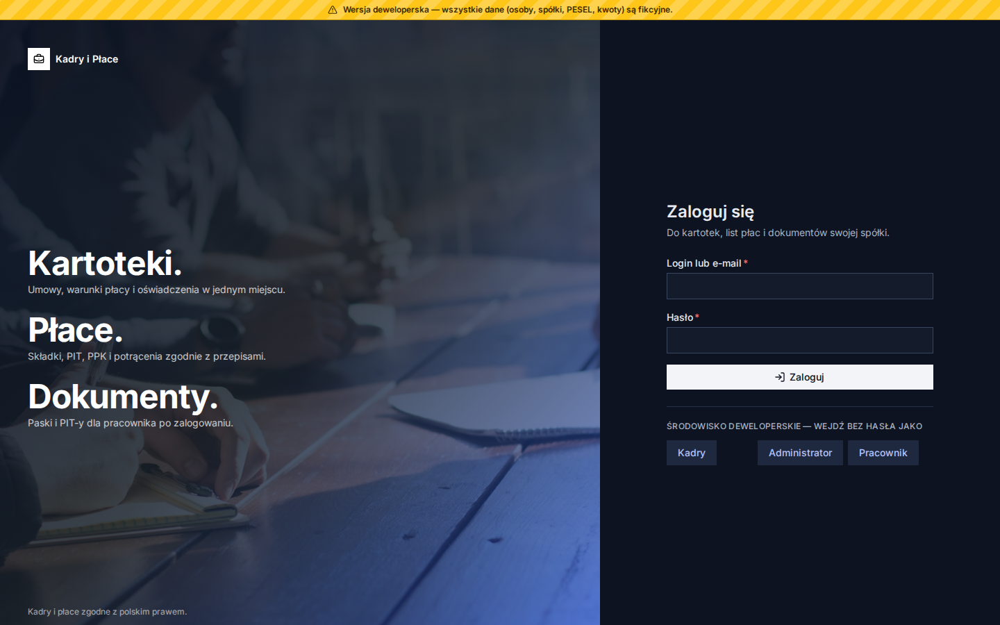<br><sub>Logowanie (w wersji deweloperskiej — przyciski ról)</sub></td><td width="50%">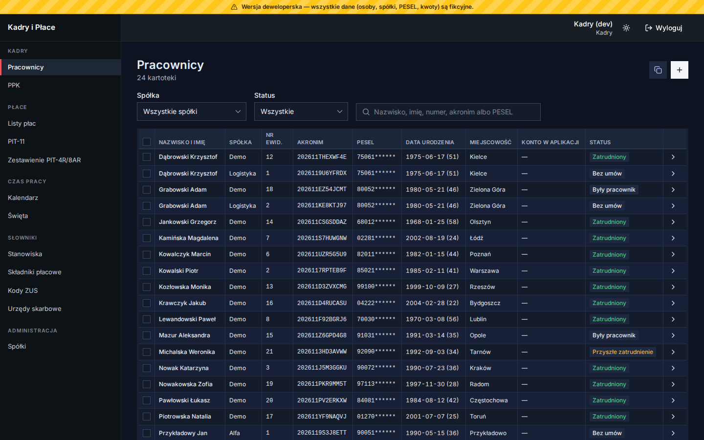<br><sub>Lista pracowników — filtry, zaznaczanie, kopiowanie do innej spółki</sub></td></tr>
<tr><td width="50%">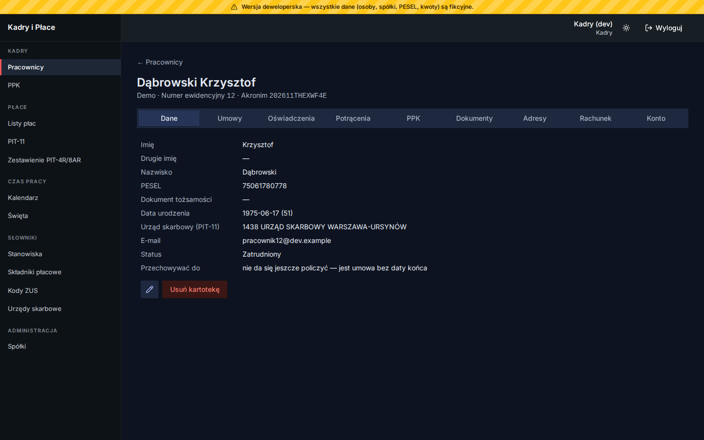<br><sub>Kartoteka pracownika z zakładkami</sub></td><td width="50%">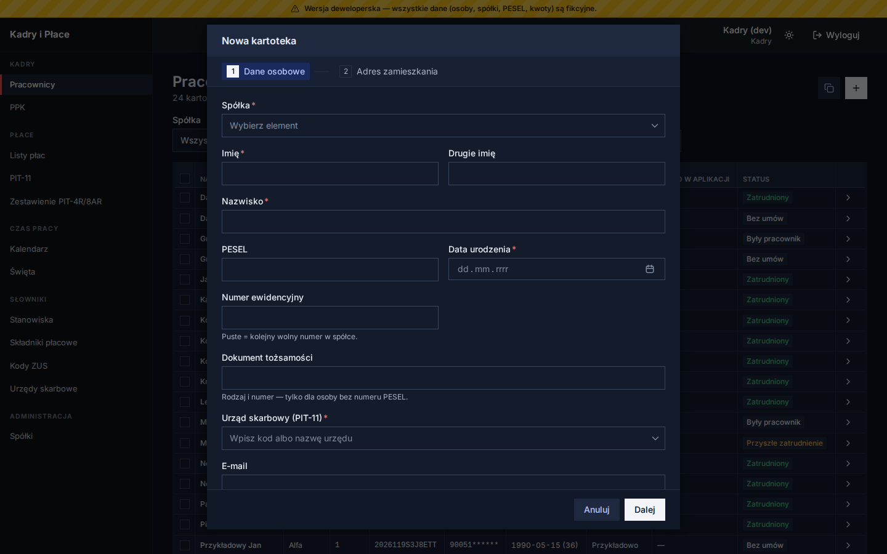<br><sub>Nowa kartoteka — kreator w szerokim dialogu</sub></td></tr>
<tr><td width="50%">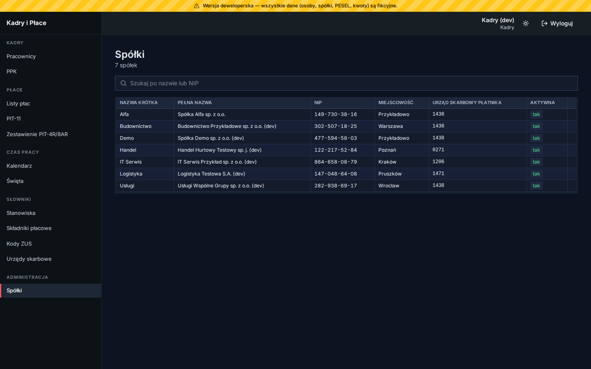<br><sub>Spółki</sub></td><td width="50%">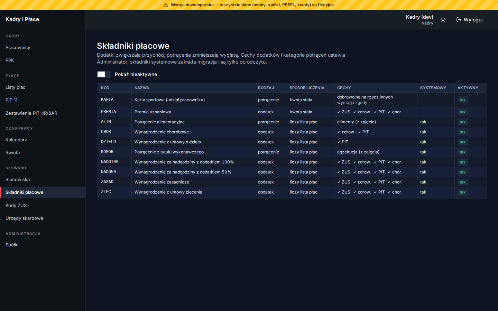<br><sub>Składniki płacowe</sub></td></tr>
<tr><td width="50%">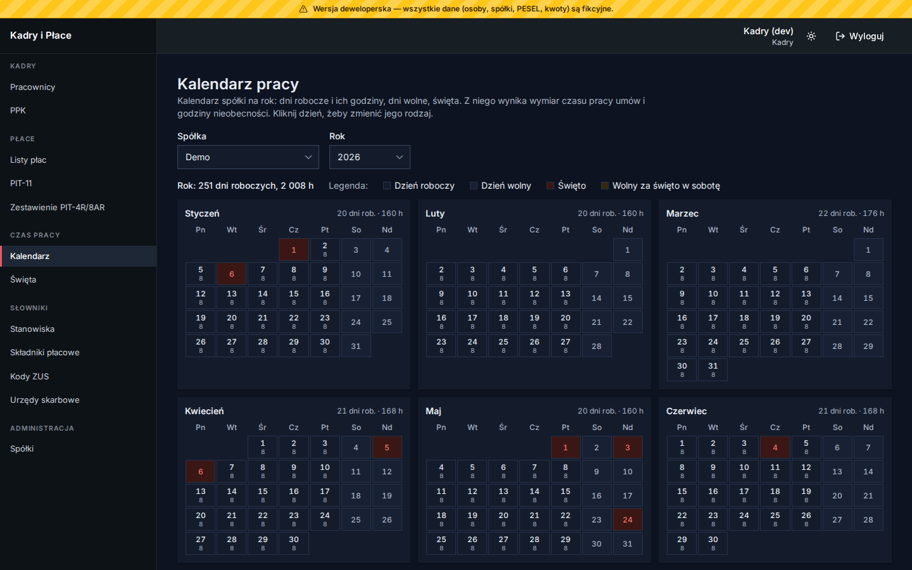<br><sub>Kalendarz czasu pracy spółki</sub></td><td width="50%">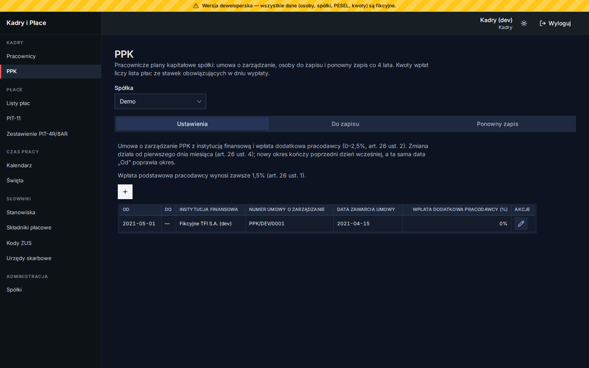<br><sub>PPK — uczestnicy i wpłaty</sub></td></tr>
<tr><td width="50%">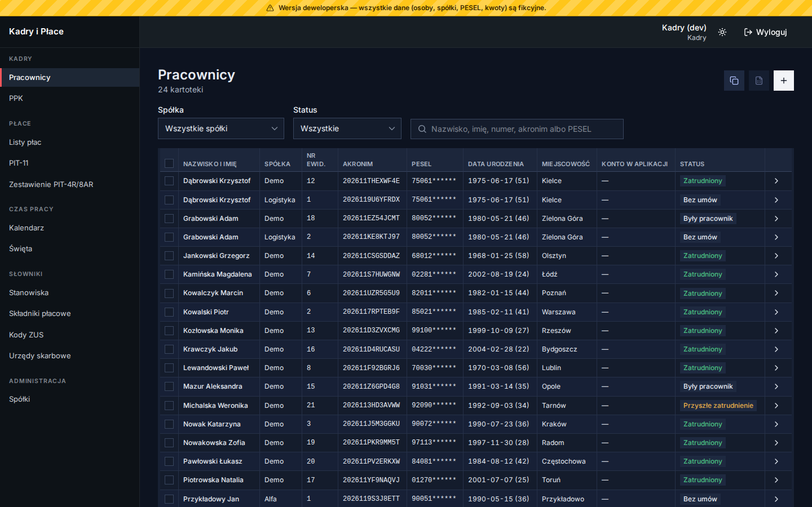<br><sub>Parametry prawne z okresem obowiązywania</sub></td><td width="50%">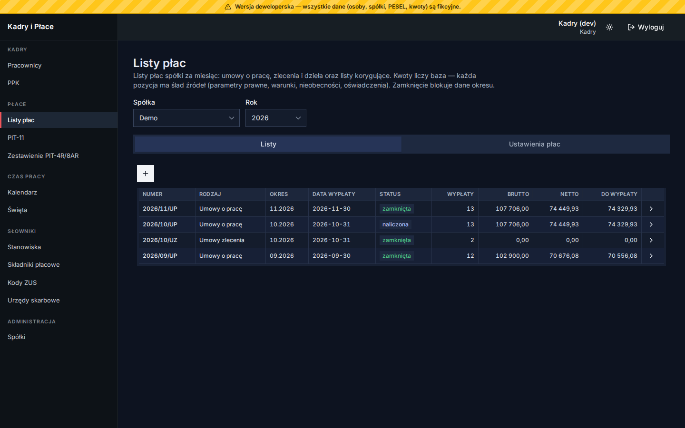<br><sub>Listy płac spółki za rok</sub></td></tr>
<tr><td width="50%">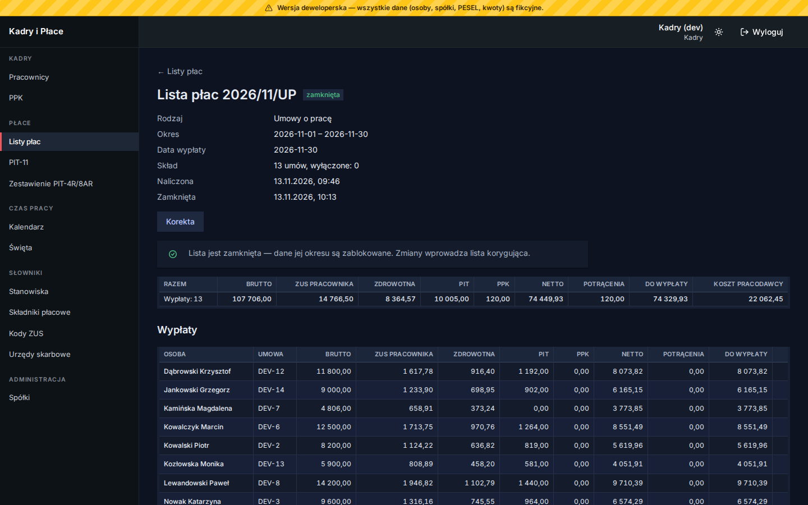<br><sub>Lista płac z sumami i wypłatami</sub></td><td width="50%">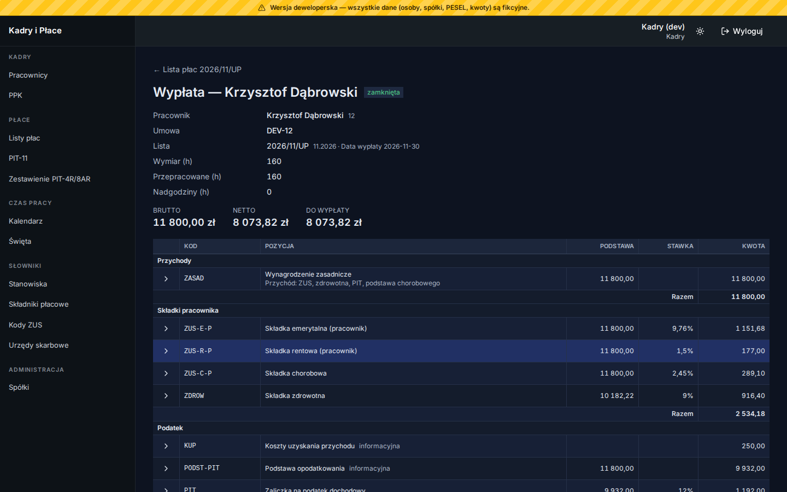<br><sub>Wypłata — pozycje i ślad źródeł</sub></td></tr>
<tr><td width="50%">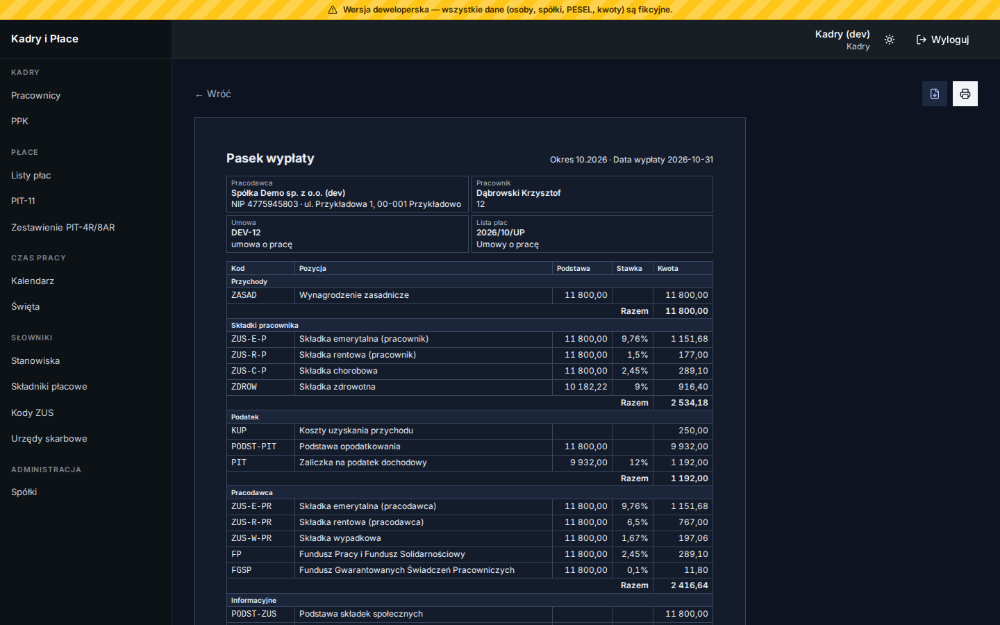<br><sub>Pasek wypłaty (strona do wydruku)</sub></td><td width="50%">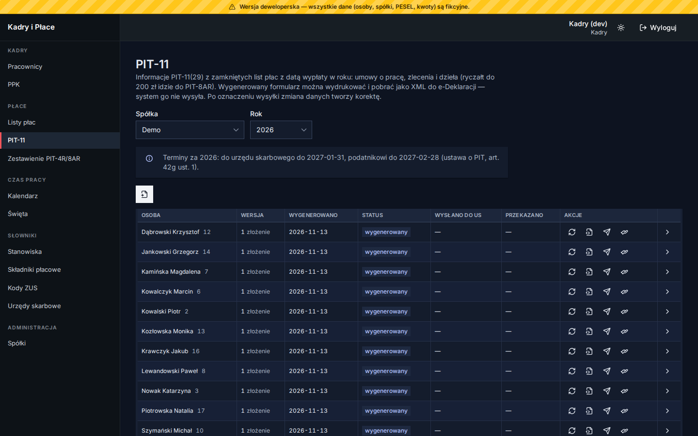<br><sub>PIT-11 — generowanie i status wysłania</sub></td></tr>
<tr><td width="50%">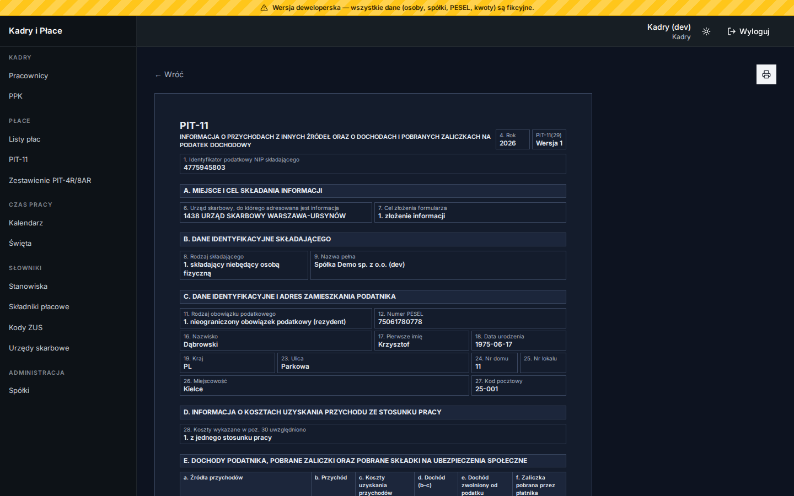<br><sub>PIT-11(29) — strona do wydruku</sub></td><td width="50%">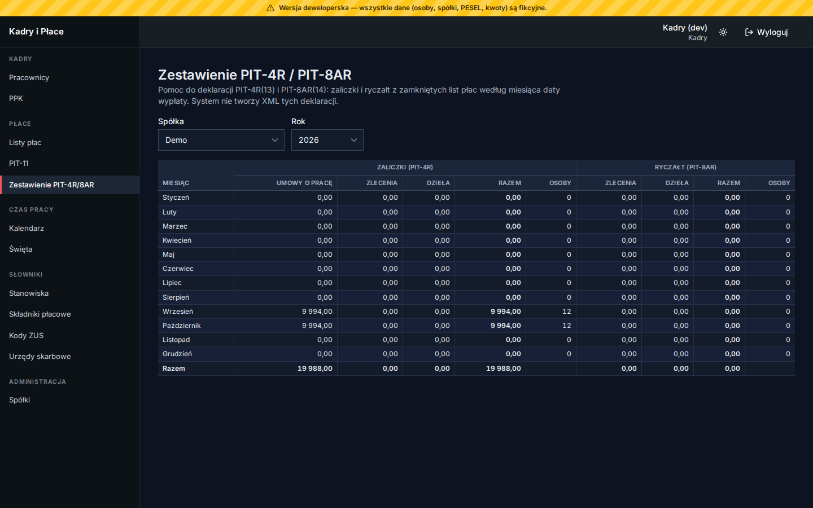<br><sub>Zestawienie do PIT-4R i PIT-8AR</sub></td></tr>
</table>

## Stan prawny: listopad 2026

Reguły i stawki odwzorowują przepisy obowiązujące **w listopadzie 2026 r.** (teksty jednolite podane
w specyfikacjach, np. ustawa o PIT Dz.U. 2026 poz. 592, Kodeks pracy Dz.U. 2026 poz. 1245, KPC Dz.U. 2026 poz. 468,
płaca minimalna 2026 i 2027). Każda reguła ma w specyfikacji podstawę prawną. Zasada: **czego nie wiemy, tego nie
liczymy** — przypadek bez potwierdzonej reguły (np. podstawa chorobowego z uzupełnieniem, limit 50% kosztów autorskich,
PIT-11 za rok bez sprawdzonego wzoru) daje ostrzeżenie blokujące zamknięcie listy albo błąd z powodem, a nie kwotę
zgadniętą z praktyki. Prawo się zmienia — po tej dacie sprawdź przepisy sam albo
z doradcą podatkowym lub prawnikiem. Parametry z okresem obowiązywania (stawki, limity) zmienia się w aplikacji bez
wydania nowej wersji.

## Forkuj i utrzymuj własną wersję

Projekt jest na licencji **MIT** (`LICENSE`): możesz go używać, zmieniać i rozpowszechniać, także komercyjnie,
bez gwarancji. **Zachęcamy do forkowania** i prowadzenia własnej wersji — pod swoją firmę, biuro rachunkowe albo
grupę spółek. Żeby było to łatwe:

- logika jest w bazie i opisana specyfikacjami (`docs/specs/NNN-…/spec.md` — wymagania z podstawą prawną,
  `plan.md`, `tasks.md` z mapą wymaganie → test), więc wiadomo, co i dlaczego zmienić, gdy zmieni się prawo;
- decyzje architektoniczne są w `docs/adr/`, model domeny w `docs/domain/`, produkt w `PRODUCT.md`;
- testy działają na prawdziwym PostgreSQL (Testcontainers) — po zmianie przepisu zmieniasz regułę i jej test.

Gotowe moduły: 001 Platforma (logowanie, role, spółki, parametry prawne, użytkownicy, audyt), 002 Słowniki,
003 Pracownicy (kartoteki, akronim, szyfrowany PESEL, kopiowanie między spółkami), 004 Zatrudnienie, 005 Oświadczenia
podatkowe, 006 Składniki, zgody i zajęcia, 007 Czas pracy i nieobecności, 008 PPK, 009 Listy płac, 010 Dokumenty i PIT (`PRODUCT.md`).

## Stack

- API: .NET 11, ASP.NET Core Minimal API, czysty Npgsql (`apps/api`)
- Logika: PostgreSQL 18, procedury i funkcje, migracje Liquibase 4.33 (`db/`)
- Front: TanStack Start + Router + Query + Form, HeroUI v3, Tailwind v4, Yarn 4, Biome (`apps/web`)
- Testy: xUnit + Testcontainers na prawdziwym PostgreSQL (`tests/`), Vitest (`apps/web`)

## Wymagania

- .NET SDK 11 (`global.json`), Node.js 22.12+ z Corepack (`corepack enable`), Docker

## Uruchomienie całości w Dockerze

```bash
infrastructure/start.sh          # Windows: infrastructure\start.ps1
```

Tworzy `infrastructure/.env` z `.env-sample` (wartości deweloperskie), stawia PostgreSQL, zakłada role, migruje
i uruchamia API oraz front:

- front: http://127.0.0.1:6301
- API: http://127.0.0.1:6300 (OpenAPI `/openapi/v1.json`, Scalar `/scalar`, `/health`)
- baza: `127.0.0.1:6332`, baza `hr`

W Development strona logowania ma przyciski „Zaloguj jako Kadry / Administrator / Pracownik” (konta deweloperskie
bez hasła).

## Praca nad kodem

```bash
infrastructure/start.sh --db-only               # tylko baza + migracje
dotnet run --project apps/api/HrWebApp.Api      # API na :6300 (appsettings.Development.json)
cd apps/web && yarn install && yarn dev         # front na :6301 (HR_API_URL, domyślnie :6300)
```

Po zmianie w `db/` uruchom ponownie migracje: `docker compose -f infrastructure/docker-compose.yml up migrate`.

Fikcyjne numery PESEL dla kartotek deweloperskich bez PESEL (szyfrowane kluczem `HR_DATA_KEY` z `infrastructure/.env`;
migracja tego nie robi, bo nie zna klucza): `scripts/dev-pesel.sh`.

## Konfiguracja API (zmienne środowiskowe)

| Zmienna | Domyślnie | Znaczenie |
|---|---|---|
| `ConnectionStrings__Hr` | — | połączenie jako rola `hr_api` (wymagane) |
| `Auth__SessionHours` | 12 | ważność sesji |
| `Auth__MaxFailedAttempts` / `Auth__LockoutMinutes` | 5 / 15 | blokada po nieudanych próbach logowania |
| `Auth__MinPasswordLength` | 6 | minimalna długość hasła nadawanego przez Administratora (hasło musi też mieć cyfrę) |
| `Auth__DevLogin` | false | logowanie jednym kliknięciem; działa tylko w `Development` |
| `Auth__BootstrapAdmin__Login`, `__Email`, `__Password`, `__DisplayName` | — | pierwszy Administrator przy starcie, gdy żadnego nie ma |
| `Data__EncryptionKey` | — (wymagany) | klucz szyfrowania PESEL i rachunku, co najmniej 32 znaki ([ADR-0009](docs/adr/0009-personal-data-encryption.md)); utrata = utrata tych danych. Compose: `HR_DATA_KEY` w `infrastructure/.env`, przy `dotnet run` ustaw zmienną sam |

Front: `HR_API_URL` (adres API widziany z serwera frontu, domyślnie `http://localhost:6300`), `HR_API_TIMEOUT_MS`
(limit czasu wywołania API, domyślnie 30000 — po nim użytkownik widzi „serwer chwilowo nie odpowiada”).
Migracje produkcyjne: Liquibase z `--contexts=main` (bez kont deweloperskich).

## Build, testy, format

```bash
dotnet build
dotnet test                                     # wymaga Dockera (Testcontainers)
dotnet test --filter "FullyQualifiedName~Positions"
dotnet csharpier check .                        # format: dotnet csharpier format .
scripts/inspect-code.sh                         # JetBrains inspectcode (narzędzie globalne jb)

cd apps/web
yarn check && yarn typecheck && yarn test && yarn build
```

## Kontrakt API i klient frontu

Endpointy są pisane ręcznie; klient TypeScript generuje orval z migawki `apps/web/openapi/hr-v1.json` (ADR-0005):

```bash
UPDATE_OPENAPI_SNAPSHOT=1 dotnet test --filter OpenApiSnapshotTests
cd apps/web && yarn api:gen
```

## Integracja z Comarch ERP Optima

Z Optimą u klienta rozmawia osobna usługa Windows (Ambit Optima Integrator), która pyta API o pracę co 500 ms —
u klienta nic nie nasłuchuje ([ADR-0010](docs/adr/0010-optima-agent-integration.md), specyfikacja
[011](docs/specs/011-optima-integration/spec.md)). Administrator zakłada klucz agenta (`POST /api/optima/agent-keys`,
token pokazany raz) i wpisuje go w instalatorze integratora. Endpointy agenta są pod `/api/optima/agent/…`
i przyjmują tylko nagłówek `X-Optima-Agent-Key`.

## Git hooks (Husky.Net)

`dotnet restore` instaluje hooki. pre-commit: `csharpier check`, `dotnet build`; pre-push: build i
`scripts/inspect-code.sh`. Testy uruchamia się ręcznie. Wyłączenie: `HUSKY=0`.

## Licencja

MIT — `LICENSE`. Oprogramowanie jest dostarczane „tak jak jest”, bez gwarancji; za zgodność rozliczeń z prawem
odpowiada ten, kto go używa.

Biblioteki z własnymi licencjami: NPOI 2.7.x (Apache-2.0, arkusz `.xls` dla Optimy — wersje 2.8+ mają inną licencję),
PDFsharp-MigraDoc 6.2.4 (MIT, PDF paska — wersja przypięta, przed podbiciem sprawdź licencję), czcionka Noto Sans
(SIL OFL 1.1, `apps/api/HrWebApp.Api/Common/Pdf/Fonts/OFL.txt`).
