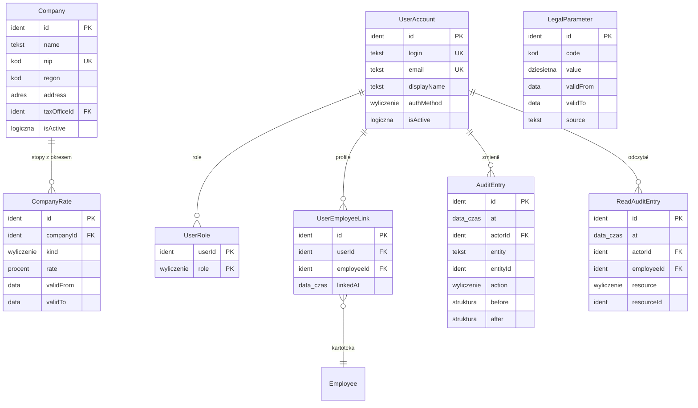

# 01. Platforma — model danych

[← Model domeny](README.md) · Zakres: [PRODUCT.md](../../PRODUCT.md)

Platforma trzyma to, z czego korzystają wszystkie moduły: spółki grupy (pracodawców i płatników), konta użytkowników
z rolami, powiązania kont z kartotekami pracowników, parametry prawne z okresem obowiązywania i audyt. Spółki
i parametry prawne prowadzi Administrator. Wartości parametrów nie są wpisane w kod: każde naliczenie bierze je
z tabeli według daty.

| Encja | Źródło |
|---|---|
| `Company` | zakres (decyzja 2: wiele powiązanych spółek, każda jest płatnikiem) |
| `CompanyRate` | *propozycja* — stopa składki wypadkowej jest inna w każdej spółce i zmienia się co rok |
| `UserAccount` | zakres (decyzja 9: logowanie własne lub OIDC) |
| `UserRole` | zakres (decyzja 9: Kadry, Administrator, Pracownik) |
| `UserEmployeeLink` | zakres (konto pracownika powiązane z jego kartotekami w spółkach) |
| `LegalParameter` | zakres („stawki i progi z datą obowiązywania i źródłem”) |
| `AuditEntry` | zakres (decyzja 10: audyt zmian) |
| `ReadAuditEntry` | zakres (decyzja 10: audyt odczytów) |

## Diagram

Encja zewnętrzna: `Employee` (03).

## Powiązania z innymi domenami

| Kierunek | Powiązanie | Kto jest właścicielem |
|---|---|---|
| ← 03 | `UserEmployeeLink.employeeId` wskazuje kartotekę | Platforma (powiązanie), Pracownicy (kartoteka) |
| → 09 | listy płac czytają `LegalParameter` i `CompanyRate` według daty | Platforma |
| → wszystkie | każdy zapis zostawia `AuditEntry`, odczyt cudzych danych `ReadAuditEntry` | Platforma (zapisują rutyny modułów) |
| ← 02 | `Company.taxOfficeId` → `TaxOffice` | Słowniki |

---

## Company

Spółka grupy, czyli osobny pracodawca i płatnik składek oraz zaliczek PIT. Prowadzi ją Administrator. Kadry widzą
wszystkie spółki (decyzja 9).

| Atrybut | Typ | Wym. | Opis |
|---|---|---|---|
| `id` | Identyfikator | tak | **PK**. |
| `name` | Tekst | tak | Pełna nazwa, która trafia na pasek i PIT. |
| `shortName` | Tekst | tak | Nazwa w filtrach i przełączniku profilu. **UK**. |
| `nip` | Kod | tak | NIP płatnika. **UK**. |
| `regon` | Kod | tak | REGON. |
| `address` | Adres | tak | Siedziba. |
| `taxOfficeId` | Identyfikator | tak | **FK → `TaxOffice`**. Urząd skarbowy płatnika, wpisywany do PIT-4R i PIT-8AR. |
| `isActive` | Wartość logiczna | tak | Nieaktywna spółka nie dostaje nowych umów ani list płac. |

**Reguły:**
- Spółki nie usuwa się, jeśli ma dokumentację płacową w okresie retencji (decyzja 10); można ją tylko wyłączyć.

**Przykłady:**

| id | shortName | name | nip | taxOfficeId |
|---|---|---|---|---|
| `CMP-ALFA` | Alfa | Spółka Alfa sp. z o.o. | `000-000-00-01` | `US-0001` |
| `CMP-BETA` | Beta | Spółka Beta sp. z o.o. | `000-000-00-02` | `US-0001` |

- `CMP-ALFA` — spółka usługowa z trzema umowami w scenariuszu: dwa etaty i zlecenie.
- `CMP-BETA` — druga spółka grupy z etatem i umową o dzieło. Umowę o dzieło ma Anna Nowak, która ma też etat w Alfie, więc ma dwa profile.

## CompanyRate *(propozycja)*

Stawka, która zależy od płatnika, z okresem obowiązywania. Dziś to stopa składki wypadkowej, którą płatnik
ustala na rok składkowy od 1 kwietnia do 31 marca. *Wersjonowana.*

| Atrybut | Typ | Wym. | Opis |
|---|---|---|---|
| `id` | Identyfikator | tak | **PK**. |
| `companyId` | Identyfikator | tak | **FK → `Company`**. |
| `kind` | Wyliczenie | tak | `wypadkowa`. |
| `rate` | Procent | tak | Stopa. |
| `validFrom` | Data | tak | Początek okresu. |
| `validTo` | Data | nie | Koniec okresu; brak = bezterminowo. Okresy jednej spółki i jednego `kind` się nie nakładają. |

**Przykłady:**

| id | companyId | kind | rate | validFrom | validTo |
|---|---|---|---|---|---|
| `CR-ALFA-W-2026` | `CMP-ALFA` | wypadkowa | 1,67% | 2026-04-01 | 2027-03-31 |
| `CR-BETA-W-2026` | `CMP-BETA` | wypadkowa | 1,67% | 2026-04-01 | 2027-03-31 |

- Obie spółki mają podstawową stopę dla płatnika zgłaszającego do 9 ubezpieczonych (wartość: [09](09-payroll.md#parametry-scenariusza)).

## UserAccount

Konto logowania. Logowanie odbywa się hasłem albo przez zewnętrznego dostawcę OIDC (decyzja 9).

| Atrybut | Typ | Wym. | Opis |
|---|---|---|---|
| `id` | Identyfikator | tak | **PK**. |
| `login` | Tekst | tak | **UK**. |
| `email` | Tekst | tak | **UK**. Służy do zaproszenia i powiązania z kartoteką. |
| `displayName` | Tekst | tak | |
| `authMethod` | Wyliczenie | tak | `hasło`, `oidc`. |
| `isActive` | Wartość logiczna | tak | |

Hasło (skrót) i dane sesji nie należą do modelu logicznego. Ich przechowywanie opisze ADR modułu logowania.

**Przykłady:**

| id | login | email | authMethod |
|---|---|---|---|
| `USR-ADMIN` | admin | admin@alfa.example | hasło |
| `USR-KADRY` | kadry | kadry@alfa.example | hasło |
| `USR-ANOWAK` | anowak | anna.nowak@poczta.example | hasło |
| `USR-EKOW` | ekowalczyk | ewa.kowalczyk@poczta.example | hasło |

## UserRole

Rola konta. Jedno konto może mieć kilka ról.

| Atrybut | Typ | Wym. | Opis |
|---|---|---|---|
| `userId` | Identyfikator | tak | **PK, FK → `UserAccount`**. |
| `role` | Wyliczenie | tak | **PK**. `Kadry`, `Administrator`, `Pracownik`. |

**Reguły:**
- `Kadry` i `Administrator` widzą wszystkie spółki. `Pracownik` widzi tylko kartoteki z `UserEmployeeLink`.
- Rola `Pracownik` wymaga co najmniej jednego `UserEmployeeLink`.

**Przykłady:**

| userId | role |
|---|---|
| `USR-ADMIN` | Administrator |
| `USR-KADRY` | Kadry |
| `USR-ANOWAK` | Pracownik |
| `USR-EKOW` | Pracownik |

## UserEmployeeLink

Powiązanie konta z kartoteką pracownika w spółce. Kartoteki spółek są osobne (decyzja 2), więc osoba zatrudniona
w dwóch spółkach ma dwa powiązania, a w aplikacji widzi dwa profile. Powiązanie zakładają Kadry.

| Atrybut | Typ | Wym. | Opis |
|---|---|---|---|
| `id` | Identyfikator | tak | **PK**. |
| `userId` | Identyfikator | tak | **FK → `UserAccount`**. |
| `employeeId` | Identyfikator | tak | **FK → `Employee`**. Kartoteka ma najwyżej jedno konto (**UK**). |
| `linkedAt` | Data i czas | tak | |

**Przykłady:**

| id | userId | employeeId |
|---|---|---|
| `UEL-01` | `USR-ANOWAK` | `EMP-ALFA-001` |
| `UEL-02` | `USR-ANOWAK` | `EMP-BETA-002` |
| `UEL-03` | `USR-EKOW` | `EMP-BETA-001` |

- `UEL-01` i `UEL-02` — Anna Nowak ma etat w Alfie i umowę o dzieło w Becie. Po zalogowaniu widzi przełącznik profili
  „Alfa” i „Beta”, a w każdym tylko dokumenty tej spółki.

## LegalParameter

Parametr prawny z okresem obowiązywania i źródłem: stawki składek, progi i stawki PIT, kwoty zmniejszające, koszty,
limity, płaca minimalna, kwoty wolne od potrąceń. Prowadzi go Administrator. *Wersjonowana.* Nowa wartość to nowy
wpis z nowym `validFrom`; starej się nie nadpisuje, bo zamknięte listy płac muszą dać się odtworzyć.

| Atrybut | Typ | Wym. | Opis |
|---|---|---|---|
| `id` | Identyfikator | tak | **PK**. |
| `code` | Kod | tak | Nazwa parametru, np. `zus.emerytalna.pracownik`. Lista kodów jest w [09](09-payroll.md#parametry-scenariusza). |
| `value` | Liczba dziesiętna | tak | Wartość: procent jako ułamek (0,0976) albo kwota w PLN. |
| `validFrom` | Data | tak | |
| `validTo` | Data | nie | Okresy jednego `code` się nie nakładają. |
| `source` | Tekst | tak | Akt prawny albo komunikat, np. Dz.U. / M.P. z pozycją. |

**Reguły:**
- Datę, według której wybiera się parametr, określa przepis. Dla składek liczy się miesiąc, za który są należne,
  a dla zaliczki PIT dzień wypłaty. Reguła wyboru jest częścią specyfikacji liczenia wypłat; model zapewnia tylko
  okres ważności.

**Przykłady:** pełna lista parametrów 2026 ze źródłami jest w [09. Parametry scenariusza](09-payroll.md#parametry-scenariusza).

## AuditEntry

Ślad zmiany danych kadrowo-płacowych: kto, kiedy, co, stara i nowa wartość (decyzja 10). Zapisują go rutyny w bazie
w tej samej transakcji co zmianę. *Niezmienna.*

| Atrybut | Typ | Wym. | Opis |
|---|---|---|---|
| `id` | Identyfikator | tak | **PK**. |
| `at` | Data i czas | tak | |
| `actorId` | Identyfikator | tak | **FK → `UserAccount`**. |
| `entity` | Tekst | tak | Nazwa encji, np. `EmploymentTerms`. |
| `entityId` | Identyfikator | tak | |
| `action` | Wyliczenie | tak | `utworzenie`, `zmiana`, `usunięcie`. |
| `before` | Struktura | nie | Wartości przed zmianą. |
| `after` | Struktura | nie | Wartości po zmianie. |

**Przykłady:**

| id | at | actorId | entity | entityId | action |
|---|---|---|---|---|---|
| `AUD-0001` | 2026-11-24 10:12 | `USR-KADRY` | `Absence` | `ABS-01` | utworzenie |

- `AUD-0001` — Kadry rejestrują chorobę Anny Nowak w listopadzie ([07](07-time-and-absence.md#absence)).

## ReadAuditEntry

Ślad odczytu danych pracownika (kartoteki, paska, PIT, dokumentu) przez kogoś innego niż ten pracownik
(decyzja 10). *Niezmienna.*

| Atrybut | Typ | Wym. | Opis |
|---|---|---|---|
| `id` | Identyfikator | tak | **PK**. |
| `at` | Data i czas | tak | |
| `actorId` | Identyfikator | tak | **FK → `UserAccount`**. |
| `employeeId` | Identyfikator | tak | **FK → `Employee`**. Czyje dane czytano. |
| `resource` | Wyliczenie | tak | `kartoteka`, `pasek`, `pit`, `dokument`. |
| `resourceId` | Identyfikator | nie | Np. id paska. |

**Przykłady:**

| id | at | actorId | employeeId | resource | resourceId |
|---|---|---|---|---|---|
| `RAU-0001` | 2026-11-30 15:40 | `USR-KADRY` | `EMP-ALFA-001` | pasek | `PS-ALFA-2026-11-001` |

- `RAU-0001` — Kadry otwierają pasek Anny Nowak za listopad. Gdy sama Anna otworzy swój pasek, wpisu nie ma.
