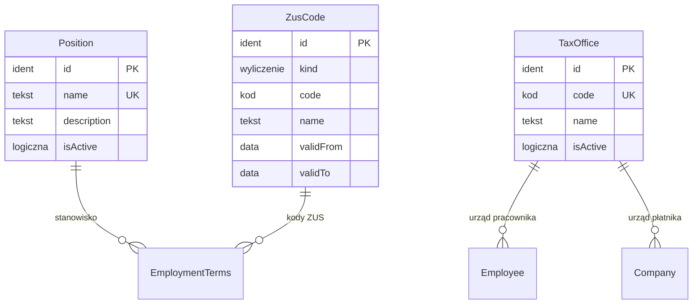

# 02. Słowniki — model danych

[← Model domeny](README.md)

Słowniki wspólne dla całej grupy: stanowiska, kody ZUS i urzędy skarbowe. Stanowiska prowadzą Kadry, kody ZUS
i urzędy Administrator. Pozycji użytej w zatrudnieniu nie usuwa się, tylko wyłącza (`isActive`), bo historia
warunków zatrudnienia musi dać się odtworzyć.

| Encja | Źródło |
|---|---|
| `Position` | zakres (stanowiska; słownik wspólny dla grupy, decyzja z modelu) |
| `ZusCode` | zakres (decyzja 7: słownik kodów ZUS i przypisanie do zatrudnienia) |
| `TaxOffice` | *propozycja* — urząd skarbowy jest wymagany w PIT-11 (urząd pracownika) i PIT-4R/PIT-8AR (urząd płatnika) |

## Diagram

Encje zewnętrzne: `EmploymentTerms` (04), `Employee` (03), `Company` (01).

## Powiązania z innymi domenami

| Kierunek | Powiązanie | Kto jest właścicielem |
|---|---|---|
| → 04 | `EmploymentTerms.positionId`, `…ZusCodeId` | Słowniki (pozycje), Zatrudnienie (przypisanie) |
| → 03, 01 | `Employee.taxOfficeId`, `Company.taxOfficeId` | Słowniki |

---

## Position

Stanowisko pracy. Słownik jest wspólny dla grupy i działa już w kodzie (`dictionaries.positions`).

| Atrybut | Typ | Wym. | Opis |
|---|---|---|---|
| `id` | Identyfikator | tak | **PK**. |
| `name` | Tekst | tak | **UK** bez względu na wielkość liter, 1–200 znaków. |
| `description` | Tekst | nie | Do 1000 znaków. |
| `isActive` | Wartość logiczna | tak | Nieaktywnego nie wybiera się w nowych warunkach zatrudnienia. |

**Przykłady:**

| id | name | isActive |
|---|---|---|
| `POS-SPEC-KP` | Specjalista ds. kadr i płac | tak |
| `POS-KONS` | Konsultant ds. obsługi klienta | tak |
| `POS-KIER-PROJ` | Kierownik projektu | tak |

- `POS-SPEC-KP` — stanowisko Anny Nowak w Alfie.
- `POS-KONS` — stanowisko Piotra Wiśniewskiego (pół etatu).
- `POS-KIER-PROJ` — stanowisko Ewy Kowalczyk w Becie.

## ZusCode

Kod ze słowników ZUS używany przy naliczeniu: kod tytułu ubezpieczenia (4 znaki), prawo do emerytury lub renty
(1 znak), stopień niepełnosprawności (1 znak). Prowadzi go Administrator na podstawie aktualnych wykazów ZUS.
*Wersjonowana* (kod może zostać wycofany).

| Atrybut | Typ | Wym. | Opis |
|---|---|---|---|
| `id` | Identyfikator | tak | **PK**. |
| `kind` | Wyliczenie | tak | `tytuł ubezpieczenia`, `prawo do emerytury/renty`, `niepełnosprawność`. |
| `code` | Kod | tak | **UK** w obrębie `kind`. |
| `name` | Tekst | tak | Opis z wykazu ZUS. |
| `insurances` | Wyliczenie (wiele) | warunkowo | Dla tytułu: obowiązkowe ubezpieczenia (`emerytalne`, `rentowe`, `chorobowe`, `wypadkowe`, `zdrowotne`). Podpowiedź przy umowie; ostatecznie rozstrzyga reguła zbiegu tytułów. |
| `validFrom` | Data | tak | |
| `validTo` | Data | nie | |

**Przykłady:**

| id | kind | code | name |
|---|---|---|---|
| `ZUS-T-0110` | tytuł ubezpieczenia | `0110` | pracownik |
| `ZUS-T-0411` | tytuł ubezpieczenia | `0411` | osoba wykonująca pracę na podstawie umowy zlecenia |
| `ZUS-E-0` | prawo do emerytury/renty | `0` | brak ustalonego prawa |
| `ZUS-N-0` | niepełnosprawność | `0` | brak orzeczenia |

- `ZUS-T-0110` — etaty Anny Nowak, Piotra Wiśniewskiego i Ewy Kowalczyk.
- `ZUS-T-0411` — zlecenie Marka Zielińskiego. Umowa o dzieło (Anna Nowak w Becie) nie ma tytułu ubezpieczenia.

## TaxOffice *(propozycja)*

Urząd skarbowy z kodem urzędu z e-Deklaracji.

| Atrybut | Typ | Wym. | Opis |
|---|---|---|---|
| `id` | Identyfikator | tak | **PK**. |
| `code` | Kod | tak | **UK**. Czteroznakowy kod urzędu. |
| `name` | Tekst | tak | |
| `isActive` | Wartość logiczna | tak | |

**Przykłady:**

| id | code | name |
|---|---|---|
| `US-0001` | `0001` | Urząd Skarbowy Przykładowo-Śródmieście |
| `US-0002` | `0002` | Urząd Skarbowy Przykładowo-Północ |

- W scenariuszu kody są fikcyjne. Prawdziwy wykaz kodów urzędów wczyta Administrator.
