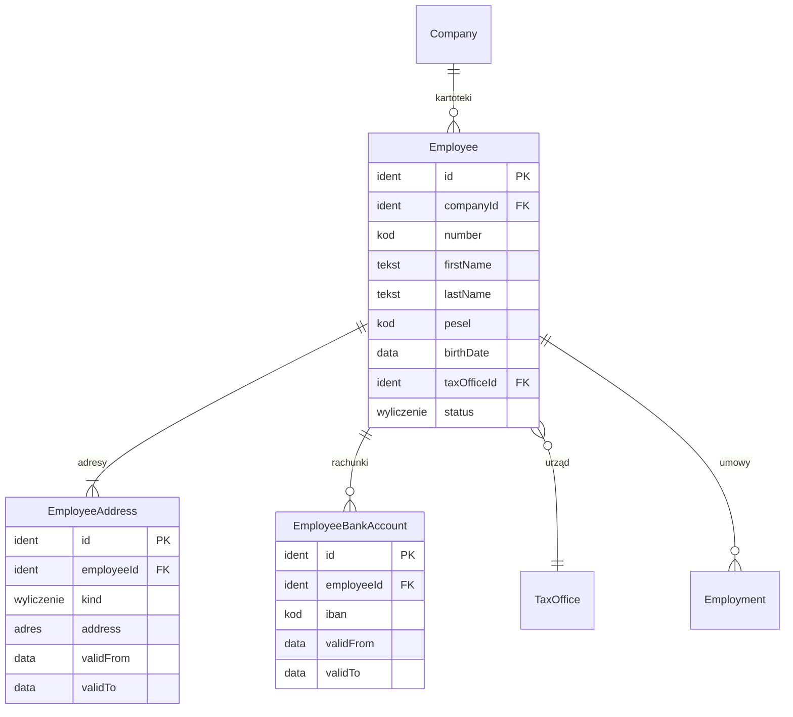

# 03. Pracownicy — model danych

[← Model domeny](README.md)

Kartoteka osoby w jednej spółce: dane osobowe, podatkowe i adresy, które są potrzebne do naliczeń, pasków i PIT.
Kartotekę prowadzą Kadry. Kartoteki spółek są od siebie niezależne (decyzja 2): ta sama osoba w dwóch spółkach to dwa
rekordy, a łączy je dopiero konto użytkownika ([01](01-platform.md#useremployeelink)). „Pracownik” oznacza w modelu
każdą osobę z kartoteką, także zleceniobiorcę i wykonawcę dzieła.

| Encja | Źródło |
|---|---|
| `Employee` | zakres (wymaganie 1: lista i kartoteka pracowników) |
| `EmployeeAddress` | *propozycja* — PIT-11 wymaga adresu zamieszkania na dzień wystawienia, więc adres musi mieć historię |
| `EmployeeBankAccount` | *propozycja* — numer rachunku do wypłaty, zaszyfrowany (decyzja 10), z historią zmian |

## Diagram

Encje zewnętrzne: `Company` (01), `TaxOffice` (02), `Employment` (04).

## Powiązania z innymi domenami

| Kierunek | Powiązanie | Kto jest właścicielem |
|---|---|---|
| → 04 | `Employment.employeeId` | Pracownicy (kartoteka), Zatrudnienie (umowa) |
| → 05, 06, 07, 08 | oświadczenia, składniki, nieobecności i PPK wskazują kartotekę | moduły 05–08 |
| ← 01 | konto `UserAccount` przez `UserEmployeeLink` | Platforma |

---

## Employee

Kartoteka osoby w spółce.

| Atrybut | Typ | Wym. | Opis |
|---|---|---|---|
| `id` | Identyfikator | tak | **PK**. |
| `companyId` | Identyfikator | tak | **FK → `Company`**. Niezmienny. |
| `number` | Kod | tak | Numer ewidencyjny. **UK** w spółce. |
| `firstName` | Tekst | tak | |
| `secondName` | Tekst | nie | Drugie imię (PIT-11). |
| `lastName` | Tekst | tak | |
| `pesel` | Kod | warunkowo | Wymagany dla osób z PESEL. **Zaszyfrowany**. Unikalność w spółce sprawdza się po skrócie HMAC (decyzja 10). |
| `foreignId` | Tekst | warunkowo | Rodzaj i numer dokumentu tożsamości, gdy osoba nie ma PESEL. |
| `birthDate` | Data | tak | Potrzebna do ulgi dla młodych, PPK (wiek 55/70) i limitu 14 dni chorobowego (50+). |
| `taxResidence` | Wyliczenie | tak | `PL`. Inne rezydencje są poza zakresem. |
| `taxOfficeId` | Identyfikator | tak | **FK → `TaxOffice`**. Urząd pracownika, do którego trafia PIT-11. |
| `email` | Tekst | nie | Do zaproszenia na konto. |
| `status` | Wyliczenie | tak | `aktywny`, `nieaktywny`. *(wyliczany)* `aktywny`, gdy osoba ma trwającą umowę. |

**Reguły:**
- PESEL, rachunek i wynagrodzenia są wrażliwe: każdy odczyt przez kogoś innego niż ten pracownik zostawia
  `ReadAuditEntry`.
- Kartoteki nie usuwa się przed końcem okresu retencji dokumentacji (decyzja 10).

**Przykłady** (dane fikcyjne, PESEL zamaskowany):

| id | companyId | number | firstName | lastName | pesel | birthDate | taxOfficeId |
|---|---|---|---|---|---|---|---|
| `EMP-ALFA-001` | `CMP-ALFA` | A/001 | Anna | Nowak | `880412•••••` | 1988-04-12 | `US-0001` |
| `EMP-ALFA-002` | `CMP-ALFA` | A/002 | Piotr | Wiśniewski | `020915•••••` | 2002-09-15 | `US-0002` |
| `EMP-ALFA-003` | `CMP-ALFA` | A/003 | Marek | Zieliński | `750220•••••` | 1975-02-20 | `US-0001` |
| `EMP-BETA-001` | `CMP-BETA` | B/001 | Ewa | Kowalczyk | `700611•••••` | 1970-06-11 | `US-0002` |
| `EMP-BETA-002` | `CMP-BETA` | B/002 | Anna | Nowak | `880412•••••` | 1988-04-12 | `US-0001` |

- `EMP-ALFA-001` — etat w Alfie, 38 lat. Choruje w listopadzie i ma nadgodziny ([07](07-time-and-absence.md)).
- `EMP-ALFA-002` — pół etatu, 24 lata. Korzysta z ulgi dla młodych (zerowy PIT) i zrezygnował z PPK.
- `EMP-ALFA-003` — umowa zlecenie w Alfie (październik–grudzień).
- `EMP-BETA-001` — etat w Becie, 56 lat. Ma zajęcie komornicze i dobrowolne potrącenie za kartę sportową ze zgodą.
- `EMP-BETA-002` — ta sama osoba co `EMP-ALFA-001`, ale osobna kartoteka w Becie (umowa o dzieło w grudniu).
  Ten sam PESEL nie narusza unikalności, bo unikalność obowiązuje w spółce.

## EmployeeAddress *(propozycja)*

Adres z okresem obowiązywania. PIT-11 bierze adres zamieszkania aktualny w dniu wystawienia. *Wersjonowana.*

| Atrybut | Typ | Wym. | Opis |
|---|---|---|---|
| `id` | Identyfikator | tak | **PK**. |
| `employeeId` | Identyfikator | tak | **FK → `Employee`**. |
| `kind` | Wyliczenie | tak | `zamieszkania`, `korespondencyjny`. |
| `address` | Adres | tak | |
| `validFrom` | Data | tak | |
| `validTo` | Data | nie | Okresy jednego `kind` się nie nakładają; adres zamieszkania jest zawsze jeden aktualny. |

**Przykłady:**

| id | employeeId | kind | address | validFrom | validTo |
|---|---|---|---|---|---|
| `ADR-001` | `EMP-ALFA-001` | zamieszkania | ul. Lipowa 1/2, 00-001 Przykładowo | 2020-01-01 | 2026-11-30 |
| `ADR-002` | `EMP-ALFA-001` | zamieszkania | ul. Klonowa 5, 00-002 Przykładowo | 2026-12-01 | |

- `ADR-002` — Anna zmienia adres 1 grudnia. PIT-11 za 2026, wystawiony w styczniu 2027, ma nowy adres.

## EmployeeBankAccount *(propozycja)*

Rachunek do przelewu wynagrodzenia. Numer jest **zaszyfrowany** (decyzja 10). Bez rachunku wypłata jest gotówkowa.

| Atrybut | Typ | Wym. | Opis |
|---|---|---|---|
| `id` | Identyfikator | tak | **PK**. |
| `employeeId` | Identyfikator | tak | **FK → `Employee`**. |
| `iban` | Kod | tak | Numer rachunku (PL + 26 cyfr). |
| `validFrom` | Data | tak | |
| `validTo` | Data | nie | Najwyżej jeden aktualny rachunek. |

**Przykłady:**

| id | employeeId | iban | validFrom |
|---|---|---|---|
| `BA-001` | `EMP-ALFA-001` | `PL•• •••• … 0001` | 2024-03-01 |
| `BA-002` | `EMP-BETA-001` | `PL•• •••• … 0002` | 2019-01-02 |
