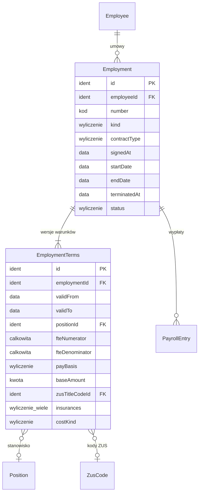

# 04. Zatrudnienie — model danych

[← Model domeny](README.md)

Umowy osoby ze spółką: umowa o pracę, umowa zlecenie i umowa o dzieło (decyzja 3). Warunki umowy (etat, stanowisko,
wynagrodzenie, kody ZUS, koszty uzyskania) mają **historię**: zmiana to nowa wersja z datą od, a stara zostaje, bo
zamknięte listy płac muszą dać się odtworzyć (wymaganie 2). Umowy prowadzą Kadry.

| Encja | Źródło |
|---|---|
| `Employment` | zakres (wymaganie 2: umowa i okres zatrudnienia; decyzja 3: trzy rodzaje umów) |
| `EmploymentTerms` | zakres (wymagania 2–5: etat, stanowisko, kody ZUS z historią) |

## Diagram

Encje zewnętrzne: `Employee` (03), `Position` i `ZusCode` (02), `PayrollEntry` (09).



## Powiązania z innymi domenami

| Kierunek | Powiązanie | Kto jest właścicielem |
|---|---|---|
| → 09 | lista płac czyta umowę i wersję warunków obowiązującą w okresie | Zatrudnienie |
| → 07 | wymiar czasu pracy wynika z etatu (`fte…`) i kalendarza spółki | Zatrudnienie (etat), Czas pracy (kalendarz) |
| → 08 | PPK dotyczy osób z obowiązkowymi składkami emerytalną i rentowymi | PPK (czyta umowy) |

---

## Employment

Umowa osoby ze spółką. Spółkę wyznacza kartoteka (`Employee.companyId`).

| Atrybut | Typ | Wym. | Opis |
|---|---|---|---|
| `id` | Identyfikator | tak | **PK**. |
| `employeeId` | Identyfikator | tak | **FK → `Employee`**. Niezmienny. |
| `number` | Kod | tak | Numer umowy. **UK** w spółce. |
| `kind` | Wyliczenie | tak | `umowa o pracę`, `umowa zlecenie`, `umowa o dzieło`. Niezmienny. |
| `contractType` | Wyliczenie | warunkowo | Tylko umowa o pracę: `na okres próbny`, `na czas określony`, `na czas nieokreślony`. |
| `signedAt` | Data | tak | |
| `startDate` | Data | tak | Początek pracy lub wykonywania umowy. |
| `endDate` | Data | warunkowo | Wymagana dla umów terminowych, zlecenia i dzieła. |
| `terminatedAt` | Data | nie | Wcześniejsze rozwiązanie. Nie późniejsze niż `endDate`. |
| `status` | Wyliczenie | tak | *(wyliczany)* `przyszła`, `trwa`, `zakończona`. |

**Statusy:**

```text
przyszła → trwa → zakończona     (wyliczane z dat i terminatedAt; nie ma ręcznego przejścia)
```

**Reguły:**
- Dwie umowy o pracę tej samej kartoteki nie nakładają się okresami.
- Umowa zlecenie nakładająca się okresem z umową o pracę tej samej kartoteki (zlecenie z własnym pracodawcą) jest
  w pierwszej wersji odrzucana błędem `U0003` ([decyzja 7.3.1](README.md#73-decyzje-do-pytań-otwartych-2026-11-12)).
- Umowy użytej na zamkniętej liście płac nie usuwa się.

**Przykłady:**

| id | employeeId | number | kind | contractType | startDate | endDate |
|---|---|---|---|---|---|---|
| `CON-ALFA-001` | `EMP-ALFA-001` | A/UP/2024/03 | umowa o pracę | na czas nieokreślony | 2024-03-01 | |
| `CON-ALFA-002` | `EMP-ALFA-002` | A/UP/2026/06 | umowa o pracę | na czas określony | 2026-06-01 | 2027-05-31 |
| `CON-ALFA-003` | `EMP-ALFA-003` | A/UZ/2026/10 | umowa zlecenie | | 2026-10-01 | 2026-12-31 |
| `CON-BETA-001` | `EMP-BETA-001` | B/UP/2019/01 | umowa o pracę | na czas nieokreślony | 2019-01-02 | |
| `CON-BETA-002` | `EMP-BETA-002` | B/UD/2026/12 | umowa o dzieło | | 2026-12-01 | 2026-12-18 |

- `CON-ALFA-003` — zlecenie Marka Zielińskiego rozliczane godzinowo. Godziny są w [07](07-time-and-absence.md#worktimeentry).
- `CON-BETA-002` — dzieło Anny Nowak w Becie (opracowanie materiałów szkoleniowych, prawa autorskie). Anna nie ma
  w Becie innej umowy, więc dzieło nie jest oskładkowane.

## EmploymentTerms

Wersja warunków umowy z okresem obowiązywania. *Wersjonowana.* Wersje jednej umowy pokrywają cały jej okres
bez luk i nakładania.

| Atrybut | Typ | Wym. | Opis |
|---|---|---|---|
| `id` | Identyfikator | tak | **PK**. |
| `employmentId` | Identyfikator | tak | **FK → `Employment`**. |
| `validFrom` | Data | tak | |
| `validTo` | Data | nie | |
| `positionId` | Identyfikator | warunkowo | **FK → `Position`**. Wymagany dla umowy o pracę. |
| `fteNumerator` / `fteDenominator` | Liczba całkowita | warunkowo | Wymiar etatu, np. 1/2. Wymagany dla umowy o pracę. |
| `payBasis` | Wyliczenie | tak | `miesięczne` (umowa o pracę), `godzinowe` (zlecenie wg godzin), `kwota umowy` (zlecenie ryczałtowe, dzieło). |
| `baseAmount` | Kwota | tak | Wynagrodzenie zasadnicze za pełny miesiąc, stawka za godzinę albo kwota umowy, w PLN. |
| `zusTitleCodeId` | Identyfikator | warunkowo | **FK → `ZusCode`** (tytuł). Wymagany dla umowy o pracę i zlecenia. |
| `zusPensionCodeId` / `zusDisabilityCodeId` | Identyfikator | warunkowo | **FK → `ZusCode`**. Jak wyżej. |
| `insurances` | Wyliczenie (wiele) | tak | Ubezpieczenia naliczane z tej umowy: `emerytalne`, `rentowe`, `chorobowe`, `wypadkowe`, `zdrowotne`, `FP`, `FGŚP`. Dla dzieła bez innego tytułu w tej spółce: pusty zbiór. |
| `costKind` | Wyliczenie | tak | Umowa o pracę: `podstawowe`, `podwyższone`. Zlecenie i dzieło: `20%`, `50% autorskie`. |
| `isPpkEligible` | Wartość logiczna | tak | *(wyliczany)* Umowa daje prawo do PPK, gdy podlega obowiązkowo ubezpieczeniom emerytalnemu i rentowym. |

**Reguły:**
- Wynagrodzenie zasadnicze za pełny etat nie może być niższe niż płaca minimalna w proporcji do etatu, a stawka
  zlecenia za godzinę niższa niż minimalna stawka godzinowa (wartości z `LegalParameter`, sprawdza baza).

**Przykłady:**

| id | employmentId | validFrom | validTo | positionId | fte | payBasis | baseAmount | zusTitleCodeId | costKind |
|---|---|---|---|---|---|---|---|---|---|
| `TRM-001` | `CON-ALFA-001` | 2024-03-01 | 2026-09-30 | `POS-SPEC-KP` | 1/1 | miesięczne | 7 000,00 | `ZUS-T-0110` | podstawowe |
| `TRM-002` | `CON-ALFA-001` | 2026-10-01 | | `POS-SPEC-KP` | 1/1 | miesięczne | 7 500,00 | `ZUS-T-0110` | podstawowe |
| `TRM-003` | `CON-ALFA-002` | 2026-06-01 | | `POS-KONS` | 1/2 | miesięczne | 2 600,00 | `ZUS-T-0110` | podstawowe |
| `TRM-004` | `CON-ALFA-003` | 2026-10-01 | | | | godzinowe | 40,00 | `ZUS-T-0411` | 20% |
| `TRM-005` | `CON-BETA-001` | 2019-01-02 | | `POS-KIER-PROJ` | 1/1 | miesięczne | 12 000,00 | `ZUS-T-0110` | podstawowe |
| `TRM-006` | `CON-BETA-002` | 2026-12-01 | | | | kwota umowy | 2 000,00 | | 50% autorskie |

- `TRM-001` → `TRM-002` — podwyżka Anny od października. Lista za wrzesień liczyła się z 7 000 zł, od października
  z 7 500 zł.
- `TRM-003` — pół etatu Piotra. 2 600 zł to więcej niż połowa płacy minimalnej 2026 (sprawdzenie w [09](09-payroll.md#parametry-scenariusza)).
- `TRM-004` — zlecenie Marka: ubezpieczenia emerytalne, rentowe, wypadkowe, zdrowotne i dobrowolne chorobowe
  (`insurances` = wszystkie pięć). FP i FGŚP dla zleceniobiorcy zależą od progów (np. FP przy podstawie co najmniej
  równej płacy minimalnej); regułę potwierdzi specyfikacja liczenia, a scenariusz jej nie rozstrzyga.
- `TRM-006` — dzieło Anny w Becie: koszty 50% (prawa autorskie), bez ubezpieczeń.
