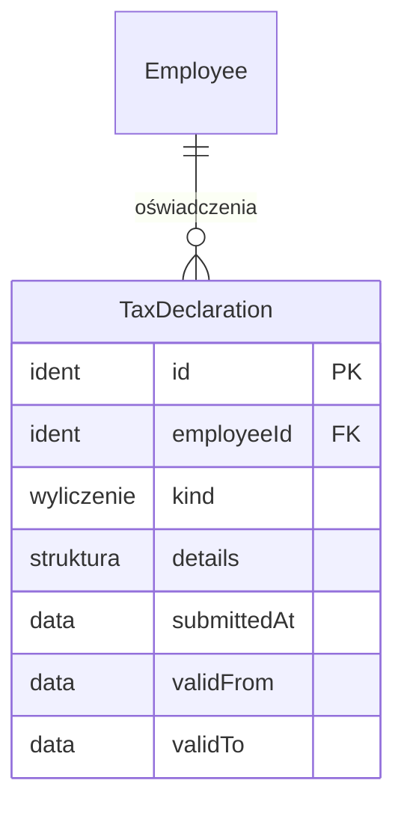

# 05. Oświadczenia podatkowe — model danych

[← Model domeny](README.md)

Oświadczenia i wnioski pracownika, które zmieniają naliczenie zaliczki PIT: PIT-2 (kwota zmniejszająca), zwolnienia
z PIT (ulga dla młodych i pozostałe ulgi zerowe), podwyższone koszty uzyskania i rezygnacje. Każde ma okres
obowiązywania (decyzja 6). Wpisują je Kadry na podstawie dokumentu od pracownika, a pracownik widzi swoje
oświadczenia w samoobsłudze.

| Encja | Źródło |
|---|---|
| `TaxDeclaration` | zakres (wymaganie 11 i decyzja 6: rejestr PIT-2 i oświadczeń z datą od–do) |

## Diagram

Encja zewnętrzna: `Employee` (03).

## Powiązania z innymi domenami

| Kierunek | Powiązanie | Kto jest właścicielem |
|---|---|---|
| → 09 | naliczenie zaliczki czyta oświadczenia ważne w dniu wypłaty | Oświadczenia |

---

## TaxDeclaration

Oświadczenie albo wniosek pracownika. Oświadczenie należy do kartoteki w jednej spółce, bo każda spółka jest osobnym
płatnikiem. *Niezmienna* co do treści; zakończenie obowiązywania polega na ustawieniu `validTo` albo złożeniu
oświadczenia odwołującego.

| Atrybut | Typ | Wym. | Opis |
|---|---|---|---|
| `id` | Identyfikator | tak | **PK**. |
| `employeeId` | Identyfikator | tak | **FK → `Employee`**. |
| `kind` | Wyliczenie | tak | Lista z podstawą prawną w [specyfikacji 005 R1](../specs/005-tax-declarations/spec.md): PIT-2, wniosek o niestosowanie ulgi dla młodych, ulgi na powrót / dla rodzin 4+ / dla seniorów, podwyższone koszty, wnioski o niestosowanie kosztów pracowniczych i kosztów 50%, niepobieranie zaliczek, wyższa stawka. |
| `details` | Struktura | warunkowo | Dla PIT-2: `share` = `1/12`, `1/24`, `1/36` (art. 31b ust. 3; wybiera podatnik); dla ulgi na powrót: `yearFrom`, `yearTo`. |
| `submittedAt` | Data | tak | Data złożenia. Płatnik stosuje wpis od miesiąca złożenia albo najpóźniej od następnego (art. 31a ust. 5). |
| `validFrom` | Data | tak | Początek stosowania. |
| `validTo` | Data | nie | Koniec stosowania. |

**Reguły:**
- Ulga dla młodych działa z mocy prawa do 26. urodzin i limitu rocznego, bez oświadczenia. Oświadczenie jest
  potrzebne tylko do rezygnacji z niej, dlatego `kind` ma rezygnację, a nie zgłoszenie.
- Oświadczenia PIT-2 jednej kartoteki nie nakładają się.

**Przykłady:**

| id | employeeId | kind | details | submittedAt | validFrom | validTo |
|---|---|---|---|---|---|---|
| `TD-001` | `EMP-ALFA-001` | PIT-2 | share = 1/12 | 2024-02-26 | 2024-03-01 | |
| `TD-002` | `EMP-BETA-001` | PIT-2 | share = 1/12 | 2019-01-02 | 2019-01-02 | |

- `TD-001` — Anna stosuje kwotę zmniejszającą w Alfie. W Becie (dzieło) PIT-2 nie złożyła, więc tam zaliczka idzie
  bez zmniejszenia.
- Piotr (`EMP-ALFA-002`) nie ma oświadczeń: do 26. urodzin (15.09.2028) przychód z etatu jest zwolniony do limitu,
  więc zaliczka PIT wynosi 0 ([09](09-payroll.md)).
