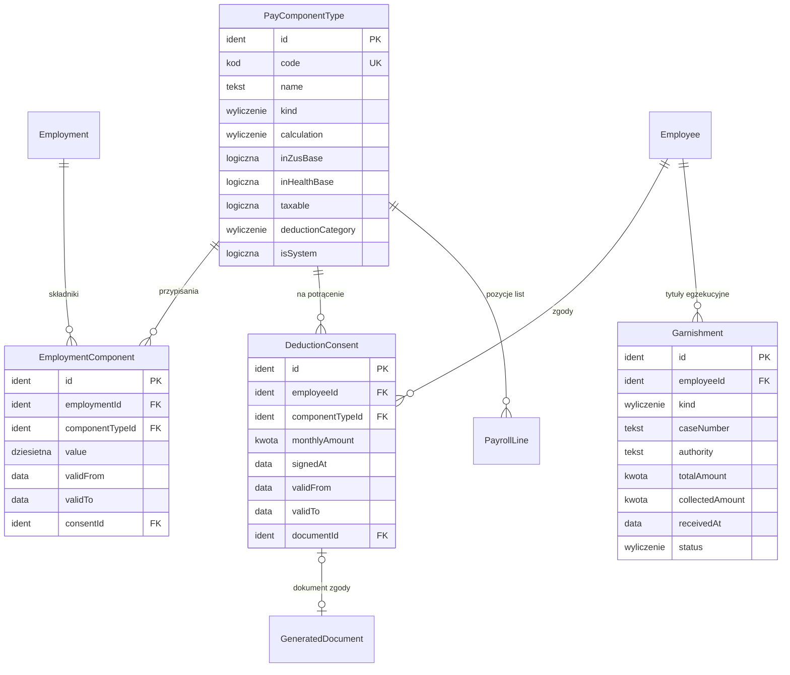

# 06. Składniki płacowe i zgody na potrącenia — model danych

[← Model domeny](README.md)

Definicje dodatków i potrąceń z cechami, które decydują o naliczeniu (podstawa składek, zdrowotnej i podatku),
przypisanie składników do umów, zgody pracownika na potrącenia oraz tytuły egzekucyjne (wymagania 6 i 10).
Definicje prowadzi Administrator, a przypisania, zgody i tytuły egzekucyjne Kadry.

| Encja | Źródło |
|---|---|
| `PayComponentType` | zakres (wymaganie 6: definicje dodatków i potrąceń z właściwościami prawnymi) |
| `EmploymentComponent` | zakres (wymaganie 6: przypisanie do pracownika lub zatrudnienia) |
| `DeductionConsent` | zakres (wymaganie 10: rejestr zgód powiązany z potrąceniem) |
| `Garnishment` | *propozycja* — kolejność i limity potrąceń z art. 87 KP zależą od tytułu (alimenty, inne egzekucje), więc tytuł musi być encją z kwotą do ściągnięcia |

## Diagram

Encje zewnętrzne: `Employment` (04), `Employee` (03), `GeneratedDocument` (10), `PayrollLine` (09).



## Powiązania z innymi domenami

| Kierunek | Powiązanie | Kto jest właścicielem |
|---|---|---|
| → 09 | naliczenie czyta składniki, zgody i tytuły egzekucyjne ważne w okresie listy | Składniki |
| ← 09 | potrącenie komornicze na zamkniętej liście zwiększa `Garnishment.collectedAmount` | Składniki (wylicza z pozycji list) |
| → 10 | zgoda ma wygenerowany dokument do podpisu | Dokumenty |

---

## PayComponentType

Definicja składnika: dodatek (zwiększa przychód) albo potrącenie (zmniejsza wypłatę netto). Składniki systemowe
(`isSystem`) wylicza silnik list płac i nie przypisuje się ich ręcznie.

| Atrybut | Typ | Wym. | Opis |
|---|---|---|---|
| `id` | Identyfikator | tak | **PK**. |
| `code` | Kod | tak | **UK**. Kod na pasku. |
| `name` | Tekst | tak | |
| `kind` | Wyliczenie | tak | `dodatek`, `potrącenie`. |
| `calculation` | Wyliczenie | tak | `kwota stała`, `procent zasadniczego`, `stawka × godziny`, `wyliczany przez silnik`. |
| `inZusBase` | Wartość logiczna | tak | Dodatek wchodzi do podstawy składek społecznych. |
| `inHealthBase` | Wartość logiczna | tak | Dodatek wchodzi do podstawy składki zdrowotnej. |
| `taxable` | Wartość logiczna | tak | Dodatek jest przychodem do PIT. |
| `inSicknessBase` | Wartość logiczna | tak | Dodatek wchodzi do podstawy wynagrodzenia chorobowego. |
| `deductionCategory` | Wyliczenie | warunkowo | Dla potrąceń: `zaliczka pieniężna`, `kara porządkowa`, `dobrowolne na rzecz pracodawcy`, `dobrowolne na rzecz innych` (różne kwoty wolne, art. 91 §2 KP). Alimenty i inne egzekucje to składniki systemowe `ALIM` i `KOMOR` liczone z zajęć ([specyfikacja 006 R4](../specs/006-pay-components/spec.md)). Składki, zaliczka PIT i PPK nie są tu kategoriami: liczy je silnik przed potrąceniami. |
| `requiresConsent` | Wartość logiczna | tak | *(wyliczany)* Tak dla `dobrowolne za zgodą`. |
| `isSystem` | Wartość logiczna | tak | |

**Przykłady:**

| id | code | name | kind | calculation | inZusBase | taxable | deductionCategory | isSystem |
|---|---|---|---|---|---|---|---|---|
| `PCT-ZASAD` | ZASAD | Wynagrodzenie zasadnicze | dodatek | wyliczany przez silnik | tak | tak | | tak |
| `PCT-CHOR` | CHOR | Wynagrodzenie chorobowe | dodatek | wyliczany przez silnik | nie | tak | | tak |
| `PCT-NADG50` | NADG50 | Wynagrodzenie za nadgodziny z dodatkiem 50% | dodatek | wyliczany przez silnik | tak | tak | | tak |
| `PCT-ZLEC` | ZLEC | Wynagrodzenie z umowy zlecenia | dodatek | stawka × godziny | tak | tak | | tak |
| `PCT-DZIELO` | DZIELO | Wynagrodzenie z umowy o dzieło | dodatek | kwota stała | nie | tak | | tak |
| `PCT-PREMIA` | PREMIA | Premia uznaniowa | dodatek | kwota stała | tak | tak | | nie |
| `PCT-KARTA` | KARTA | Karta sportowa (udział pracownika) | potrącenie | kwota stała | | | dobrowolne za zgodą | nie |
| `PCT-KOMOR` | KOMOR | Potrącenie komornicze | potrącenie | wyliczany przez silnik | | | egzekucja inna | tak |

- `PCT-CHOR` — wynagrodzenie chorobowe nie jest oskładkowane, ale jest opodatkowane i wchodzi do podstawy zdrowotnej.
- `PCT-DZIELO` — dzieło bez ubezpieczeń (Anna w Becie).
- `PCT-NADG50` — 150% stawki godzinowej (zwykłe wynagrodzenie za godzinę plus dodatek 50%).
- `PCT-PREMIA` — premia za październik pominięta na liście Anny i dopłacona listą korygującą ([09](09-payroll.md#payroll)).
  Czy i jak taka premia wchodzi do podstawy chorobowego, rozstrzygnie specyfikacja; scenariusz liczy chorobowe Anny
  w listopadzie bez niej, bo w listopadzie premia nie była jeszcze wypłacona.
- `PCT-KARTA` — wymaga zgody (`DC-001`), bez niej baza odrzuca przypisanie.

## EmploymentComponent

Składnik przypisany do umowy na okres, np. stała premia albo potrącenie co miesiąc.

| Atrybut | Typ | Wym. | Opis |
|---|---|---|---|
| `id` | Identyfikator | tak | **PK**. |
| `employmentId` | Identyfikator | tak | **FK → `Employment`**. |
| `componentTypeId` | Identyfikator | tak | **FK → `PayComponentType`**. Nie `isSystem`. |
| `value` | Liczba dziesiętna | tak | Kwota w PLN albo procent, zależnie od `calculation`. |
| `validFrom` | Data | tak | |
| `validTo` | Data | nie | |
| `consentId` | Identyfikator | warunkowo | **FK → `DeductionConsent`**. Wymagany, gdy składnik wymaga zgody; zgoda musi obejmować cały okres. |

**Reguły:**
- Potrącenie wymagające zgody bez ważnej zgody → błąd z bazy `U0001` (wymaganie 10).

**Przykłady:**

| id | employmentId | componentTypeId | value | validFrom | validTo | consentId |
|---|---|---|---|---|---|---|
| `EC-001` | `CON-BETA-001` | `PCT-KARTA` | 120,00 | 2026-10-01 | | `DC-001` |
| `EC-002` | `CON-ALFA-001` | `PCT-PREMIA` | 500,00 | 2026-10-01 | 2026-10-31 | |

- `EC-001` — Ewa płaci 120 zł miesięcznie za kartę sportową, potrącane z wypłaty za jej zgodą.
- `EC-002` — premia Anny za październik. Kadry wpisały ją 2 grudnia, po zamknięciu listy za październik, więc trafia
  na listę korygującą ([09](09-payroll.md#payroll)).

## DeductionConsent

Pisemna zgoda pracownika na potrącenie inne niż ustawowe (art. 91 KP). System generuje dokument zgody do podpisu
(wymaganie 10, [10](10-documents-and-pit.md#generateddocument)), a Kadry zaznaczają podpisanie.

| Atrybut | Typ | Wym. | Opis |
|---|---|---|---|
| `id` | Identyfikator | tak | **PK**. |
| `employeeId` | Identyfikator | tak | **FK → `Employee`**. |
| `componentTypeId` | Identyfikator | tak | **FK → `PayComponentType`** z `requiresConsent`. |
| `monthlyAmount` | Kwota | tak | Kwota zgody na miesiąc. Potrącenie nie może jej przekroczyć. |
| `signedAt` | Data | warunkowo | Pusta = dokument wygenerowany, jeszcze niepodpisany; zgoda wtedy nie działa. |
| `validFrom` | Data | tak | |
| `validTo` | Data | nie | Odwołanie zgody ustawia `validTo`. |
| `documentId` | Identyfikator | nie | **FK → `GeneratedDocument`**. |

**Statusy:**

```text
wygenerowana (signedAt puste) → podpisana → odwołana (validTo w przeszłości)
```

**Przykłady:**

| id | employeeId | componentTypeId | monthlyAmount | signedAt | validFrom | documentId |
|---|---|---|---|---|---|---|
| `DC-001` | `EMP-BETA-001` | `PCT-KARTA` | 120,00 | 2026-09-25 | 2026-10-01 | `DOC-DC-001` |

## Garnishment

Tytuł egzekucyjny (zajęcie wynagrodzenia przez komornika) z kwotą do ściągnięcia. Wpisują go Kadry po doręczeniu
zajęcia. Kwotę ściągniętą wylicza się z zamkniętych list płac.

| Atrybut | Typ | Wym. | Opis |
|---|---|---|---|
| `id` | Identyfikator | tak | **PK**. |
| `employeeId` | Identyfikator | tak | **FK → `Employee`**. |
| `kind` | Wyliczenie | tak | `alimenty`, `egzekucja inna`. Wyznacza limit (3/5 albo 1/2 wynagrodzenia netto) i kwotę wolną. |
| `caseNumber` | Tekst | tak | Sygnatura sprawy. |
| `authority` | Tekst | tak | Komornik albo organ egzekucyjny. |
| `totalAmount` | Kwota | tak | Kwota do ściągnięcia (należność z kosztami). |
| `collectedAmount` | Kwota | tak | *(wyliczany)* Suma potrąceń `PCT-KOMOR` z zamkniętych list. |
| `receivedAt` | Data | tak | Doręczenie zajęcia. Przy kilku tytułach decyduje kolejność. |
| `status` | Wyliczenie | tak | `aktywne`, `spłacone`, `umorzone`. |

**Przykłady:**

| id | employeeId | kind | caseNumber | totalAmount | receivedAt | status |
|---|---|---|---|---|---|---|
| `GAR-001` | `EMP-BETA-001` | egzekucja inna | Km 1/26 | 6 000,00 | 2026-10-12 | aktywne |

- `GAR-001` — zajęcie doręczone w październiku. Potrącenia zaczynają się na liście za październik i ograniczają je
  limit 1/2 netto oraz kwota wolna ([09](09-payroll.md#payrollline)).
