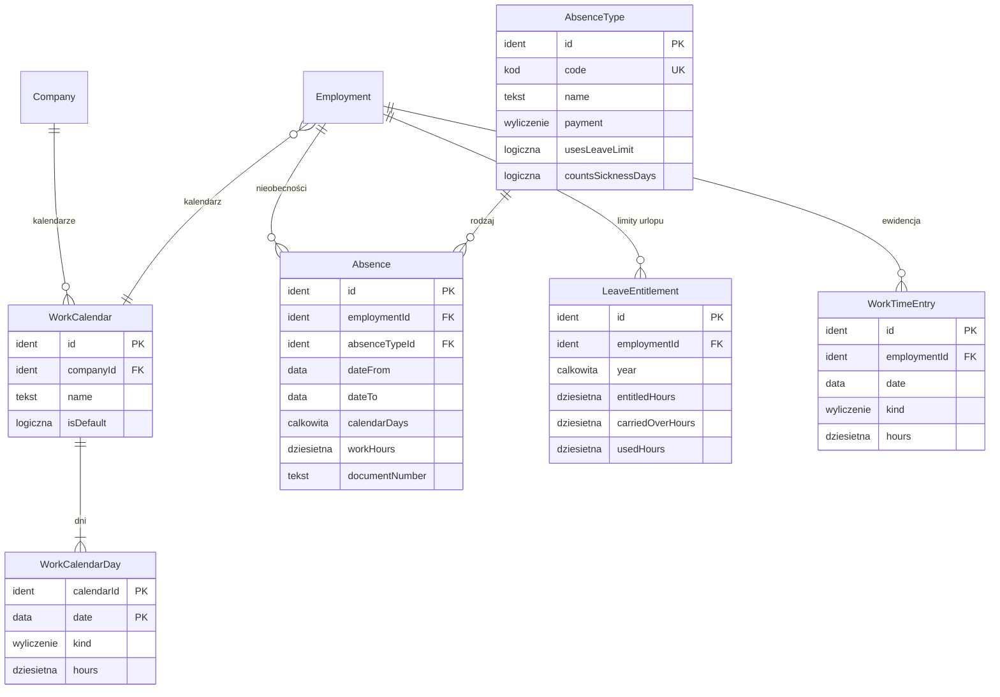

# 07. Czas pracy i nieobecności — model danych

[← Model domeny](README.md)

Osobny moduł (decyzja 4): kalendarze pracy, wymiar czasu, ewidencja godzin (nadgodziny, godziny zleceniobiorców),
nieobecności (choroba, urlopy) i limity urlopu. Lista płac czyta z niego dni i godziny, a sama ich nie zmienia.
Dane prowadzą Kadry.

| Encja | Źródło |
|---|---|
| `WorkCalendar` | zakres (decyzja 4: kalendarze) |
| `WorkCalendarDay` | zakres (decyzja 4: wymiar czasu, święta) |
| `AbsenceType` | zakres (decyzja 4: choroba, urlopy, zasiłki) |
| `Absence` | zakres (decyzja 4) |
| `LeaveEntitlement` | *propozycja* — limit urlopu na rok, żeby pilnować wykorzystania i liczyć ekwiwalent |
| `WorkTimeEntry` | zakres (decyzja 4: nadgodziny); *propozycja*: ten sam wpis ewidencjonuje godziny zlecenia (minimalna stawka godzinowa wymaga ewidencji) |

## Diagram

Encje zewnętrzne: `Company` (01), `Employment` (04).

`Employment.calendarId` *(propozycja)* — umowa o pracę wskazuje kalendarz; domyślnie kalendarz domyślny spółki.

## Powiązania z innymi domenami

| Kierunek | Powiązanie | Kto jest właścicielem |
|---|---|---|
| → 09 | lista płac czyta wymiar, nieobecności i godziny z okresu | Czas pracy |
| ← 04 | wymiar pracownika = wymiar kalendarza × etat | Zatrudnienie (etat) |

---

## WorkCalendar

Kalendarz pracy spółki: system czasu pracy i dni wolne. Spółka ma kalendarz domyślny (poniedziałek–piątek, 8 h,
święta ustawowe).

| Atrybut | Typ | Wym. | Opis |
|---|---|---|---|
| `id` | Identyfikator | tak | **PK**. |
| `companyId` | Identyfikator | tak | **FK → `Company`**. |
| `name` | Tekst | tak | |
| `isDefault` | Wartość logiczna | tak | Jeden domyślny na spółkę. |

**Przykłady:**

| id | companyId | name | isDefault |
|---|---|---|---|
| `CAL-ALFA` | `CMP-ALFA` | Podstawowy pn–pt 8 h | tak |
| `CAL-BETA` | `CMP-BETA` | Podstawowy pn–pt 8 h | tak |

## WorkCalendarDay

Dzień kalendarza z liczbą godzin pracy dla pełnego etatu. Wymiar miesiąca to suma `hours`.

| Atrybut | Typ | Wym. | Opis |
|---|---|---|---|
| `calendarId` | Identyfikator | tak | **PK, FK → `WorkCalendar`**. |
| `date` | Data | tak | **PK**. |
| `kind` | Wyliczenie | tak | `roboczy`, `wolny`, `święto`, `wolny za święto w sobotę`. |
| `hours` | Liczba dziesiętna | tak | 8 w dzień roboczy, 0 w pozostałe. |

**Wymiar w scenariuszu** (pełny etat, kalendarz podstawowy):

| Miesiąc | Dni robocze | Godziny | Święta |
|---|---|---|---|
| październik 2026 | 22 | 176 | brak |
| listopad 2026 | 20 | 160 | 1.11 (niedziela, nie obniża), 11.11 (środa) |
| grudzień 2026 | 20 | 160 | 24.12 (czwartek), 25.12 (piątek), 26.12 (sobota, obniża wymiar o 8 h, wolny dzień do wyznaczenia) |

Wigilia (24.12) jako święto i obniżenie za sobotę potwierdzają parametry w [09](09-payroll.md#parametry-scenariusza).

## AbsenceType

Rodzaj nieobecności i sposób płacenia za nią.

| Atrybut | Typ | Wym. | Opis |
|---|---|---|---|
| `id` | Identyfikator | tak | **PK**. |
| `code` | Kod | tak | **UK**. |
| `name` | Tekst | tak | |
| `payment` | Wyliczenie | tak | `wynagrodzenie urlopowe`, `wynagrodzenie chorobowe`, `zasiłek`, `bezpłatna`. Przy chorobie płatnik zmienia się po limicie dni (silnik wybiera między chorobowym a zasiłkiem). |
| `usesLeaveLimit` | Wartość logiczna | tak | Zmniejsza limit urlopu. |
| `countsSicknessDays` | Wartość logiczna | tak | Wlicza się do rocznego limitu dni wynagrodzenia chorobowego (33 albo 14). |

**Przykłady:**

| id | code | name | payment | usesLeaveLimit | countsSicknessDays |
|---|---|---|---|---|---|
| `AT-UW` | UW | Urlop wypoczynkowy | wynagrodzenie urlopowe | tak | nie |
| `AT-CH` | CH | Choroba (L4) | wynagrodzenie chorobowe | nie | tak |
| `AT-UB` | UB | Urlop bezpłatny | bezpłatna | nie | nie |

## Absence

Nieobecność pracownika w okresie. Choroba ma numer zwolnienia (e-ZLA).

| Atrybut | Typ | Wym. | Opis |
|---|---|---|---|
| `id` | Identyfikator | tak | **PK**. |
| `employmentId` | Identyfikator | tak | **FK → `Employment`** (umowa o pracę albo zlecenie z dobrowolnym chorobowym). |
| `absenceTypeId` | Identyfikator | tak | **FK → `AbsenceType`**. |
| `dateFrom` / `dateTo` | Data | tak | Włącznie. |
| `calendarDays` | Liczba całkowita | tak | *(wyliczany)* Dni kalendarzowe (choroba płatna jest za dni kalendarzowe). |
| `workHours` | Liczba dziesiętna | tak | *(wyliczany)* Godziny pracy z kalendarza × etat, które nieobecność zabrała (urlop, potrącenie z zasadniczego). |
| `documentNumber` | Tekst | warunkowo | Numer e-ZLA dla choroby. |

**Reguły:**
- Nieobecności jednej umowy się nie nakładają.
- Nieobecność w okresie zamkniętej listy płac zmienia się tylko przez listę korygującą.

**Przykłady:**

| id | employmentId | absenceTypeId | dateFrom | dateTo | calendarDays | workHours | documentNumber |
|---|---|---|---|---|---|---|---|
| `ABS-01` | `CON-ALFA-001` | `AT-CH` | 2026-11-16 | 2026-11-20 | 5 | 40 | ZLA-0001 |
| `ABS-02` | `CON-BETA-001` | `AT-UW` | 2026-12-28 | 2026-12-31 | 4 | 32 | |

- `ABS-01` — pierwsza choroba Anny w 2026 roku (poniedziałek–piątek). 5 dni wynagrodzenia chorobowego 80%
  ([09](09-payroll.md#payrollline)).
- `ABS-02` — urlop Ewy na koniec roku. Przy stałym wynagrodzeniu miesięcznym nie zmienia kwoty, zmniejsza limit.

## LeaveEntitlement *(propozycja)*

Limit urlopu wypoczynkowego umowy na rok kalendarzowy, w godzinach (urlop udziela się w dniach, rozlicza w godzinach
zależnie od etatu).

| Atrybut | Typ | Wym. | Opis |
|---|---|---|---|
| `id` | Identyfikator | tak | **PK**. |
| `employmentId` | Identyfikator | tak | **FK → `Employment`**. **UK** z `year`. |
| `year` | Liczba całkowita | tak | |
| `entitledHours` | Liczba dziesiętna | tak | 20 albo 26 dni × 8 h × etat (proporcjonalnie przy niepełnym roku). |
| `carriedOverHours` | Liczba dziesiętna | tak | Zaległy urlop z poprzedniego roku. |
| `usedHours` | Liczba dziesiętna | tak | *(wyliczany)* Suma `workHours` nieobecności z `usesLeaveLimit`. |

**Przykłady:**

| id | employmentId | year | entitledHours | carriedOverHours |
|---|---|---|---|---|
| `LE-2026-B001` | `CON-BETA-001` | 2026 | 208 | 16 |

- `LE-2026-B001` — Ewa: 26 dni × 8 h, plus 2 dni zaległe. Po `ABS-02` zostało jej 192 h (wcześniejsze urlopy w roku
  pomijamy w scenariuszu).

## WorkTimeEntry

Wpis ewidencji godzin: nadgodziny pracownika etatowego albo godziny zleceniobiorcy w danym dniu.

| Atrybut | Typ | Wym. | Opis |
|---|---|---|---|
| `id` | Identyfikator | tak | **PK**. |
| `employmentId` | Identyfikator | tak | **FK → `Employment`**. |
| `date` | Data | tak | |
| `kind` | Wyliczenie | tak | `nadgodziny 50%`, `nadgodziny 100%`, `godziny zlecenia`. |
| `hours` | Liczba dziesiętna | tak | > 0. |

**Przykłady:**

| id | employmentId | date | kind | hours |
|---|---|---|---|---|
| `WT-01` | `CON-ALFA-001` | 2026-11-26 | nadgodziny 50% | 2 |
| `WT-02` | `CON-ALFA-001` | 2026-11-27 | nadgodziny 50% | 2 |
| `WT-10` | `CON-ALFA-003` | 2026-10-31 | godziny zlecenia | 80 |
| `WT-11` | `CON-ALFA-003` | 2026-11-30 | godziny zlecenia | 90 |
| `WT-12` | `CON-ALFA-003` | 2026-12-31 | godziny zlecenia | 60 |

- `WT-01`, `WT-02` — 4 nadgodziny Anny w dni robocze (dodatek 50%).
- `WT-10`–`WT-12` — Marek ewidencjonuje godziny zlecenia zbiorczo za miesiąc (wpis z ostatnim dniem miesiąca);
  wynagrodzenie = godziny × 40 zł.
