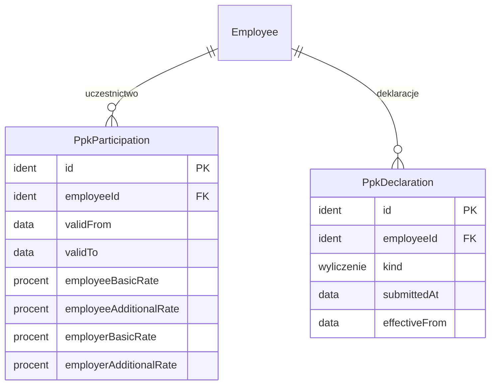

# 08. PPK — model danych

[← Model domeny](README.md)

Pracownicze Plany Kapitałowe (decyzja 5): uczestnictwo z historią stawek wpłat, deklaracje (rezygnacja, ponowny zapis,
wpłaty dodatkowe, obniżona wpłata) i automatyczny zapis co 4 lata. Wpłaty liczy lista płac. Wymiany plików
z instytucją finansową nie ma. Dane prowadzą Kadry.

| Encja | Źródło |
|---|---|
| `PpkParticipation` | zakres (decyzja 5: wpłaty podstawowe i dodatkowe) |
| `PpkDeclaration` | zakres (decyzja 5: deklaracje rezygnacji i ponownego zapisu) |

## Diagram

Encje zewnętrzne: `Employee` (03).

## Powiązania z innymi domenami

| Kierunek | Powiązanie | Kto jest właścicielem |
|---|---|---|
| → 09 | lista płac liczy wpłaty ze stawek ważnych w miesiącu | PPK |
| ← 04 | prawo do PPK wynika z umowy (`isPpkEligible`) | Zatrudnienie |

---

## PpkParticipation

Okres uczestnictwa kartoteki w PPK ze stawkami wpłat. *Wersjonowana* (zmiana stawki = nowy okres).

| Atrybut | Typ | Wym. | Opis |
|---|---|---|---|
| `id` | Identyfikator | tak | **PK**. |
| `employeeId` | Identyfikator | tak | **FK → `Employee`**. |
| `validFrom` / `validTo` | Data | tak / nie | Okresy się nie nakładają. |
| `employeeBasicRate` | Procent | tak | Podstawowa pracownika (2% albo obniżona). |
| `employeeAdditionalRate` | Procent | tak | Dodatkowa pracownika (0–2%). |
| `employerBasicRate` | Procent | tak | Podstawowa pracodawcy (1,5%). |
| `employerAdditionalRate` | Procent | tak | Dodatkowa pracodawcy (0–2,5%), jeśli spółka ją deklaruje. |

**Przykłady:**

| id | employeeId | validFrom | employeeBasicRate | employeeAdditionalRate | employerBasicRate | employerAdditionalRate |
|---|---|---|---|---|---|---|
| `PPK-001` | `EMP-ALFA-001` | 2024-06-01 | 2% | 0% | 1,5% | 0% |
| `PPK-002` | `EMP-BETA-001` | 2021-05-01 | 2% | 1% | 1,5% | 0% |

- `PPK-001` — Anna w Alfie, stawki podstawowe.
- `PPK-002` — Ewa w Becie, z dodatkową wpłatą 1%. Zapisana automatycznie w 2021 roku, gdy miała 50 lat (dziś 56;
  osobę po 55. roku życia zapisuje się już tylko na jej wniosek).

## PpkDeclaration

Deklaracja pracownika w sprawie PPK. *Niezmienna.*

| Atrybut | Typ | Wym. | Opis |
|---|---|---|---|
| `id` | Identyfikator | tak | **PK**. |
| `employeeId` | Identyfikator | tak | **FK → `Employee`**. |
| `kind` | Wyliczenie | tak | `rezygnacja`, `wniosek o zawarcie umowy` (np. 55+), `ponowny zapis automatyczny`, `wpłata dodatkowa`, `obniżona wpłata podstawowa`. |
| `submittedAt` | Data | tak | |
| `effectiveFrom` | Data | tak | Od kiedy działa (rezygnacja: od miesiąca złożenia). |

**Reguły:**
- Osoba z rezygnacją wraca do PPK z automatycznym zapisem co 4 lata (data z przepisów, parametr w `LegalParameter`),
  chyba że złoży nową rezygnację. Silnik zakłada wtedy `PpkDeclaration` rodzaju `ponowny zapis automatyczny`.

**Przykłady:**

| id | employeeId | kind | submittedAt | effectiveFrom |
|---|---|---|---|---|
| `PPKD-001` | `EMP-ALFA-002` | rezygnacja | 2026-06-01 | 2026-06-01 |

- `PPKD-001` — Piotr rezygnuje przy zatrudnieniu, więc nie ma `PpkParticipation`.
