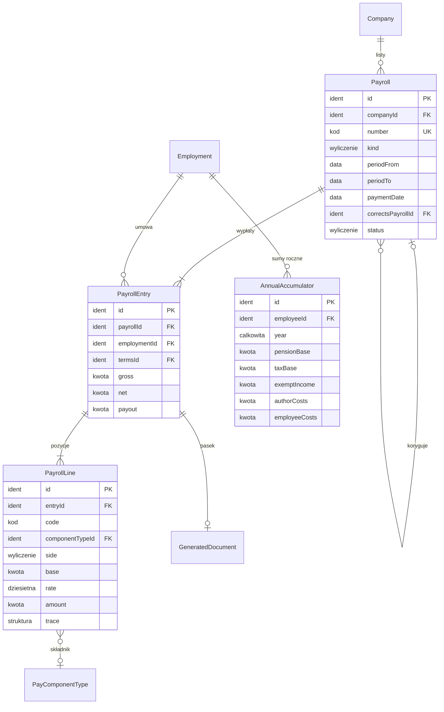
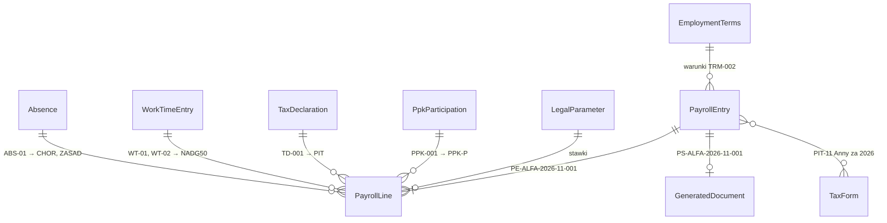

# 09. Listy płac — model danych

[← Model domeny](README.md)

Lista płac za okres w spółce, wypłata każdej umowy na liście i pozycje naliczenia ze śladem parametrów
(wymagania 7–8). Liczy baza: czyta zatrudnienie, czas pracy, składniki, oświadczenia i PPK, a stawki bierze
z `LegalParameter` według daty. Zamkniętej listy nie zmienia się; błąd poprawia lista korygująca (decyzja 8).
Listy prowadzą Kadry.

| Encja | Źródło |
|---|---|
| `Payroll` | zakres (wymaganie 7: lista płac za okres, stany, korekta) |
| `PayrollEntry` | zakres (wymaganie 8: wypłata pracownika) |
| `PayrollLine` | zakres (wymaganie 8: każde naliczenie ma ślad parametrów) |
| `AnnualAccumulator` | *propozycja* — próg PIT, 30-krotność, limit ulgi dla młodych i kosztów autorskich liczy się narastająco od początku roku |

## Diagram

Encje zewnętrzne: `Company` (01), `Employment` i `EmploymentTerms` (04), `PayComponentType` (06),
`LegalParameter` (01), `GeneratedDocument` (10).



## Powiązania z innymi domenami

| Kierunek | Powiązanie | Kto jest właścicielem |
|---|---|---|
| ← 04, 05, 06, 07, 08 | naliczenie czyta warunki, oświadczenia, składniki, czas i PPK z okresu | moduły źródłowe |
| ← 01 | stawki z `LegalParameter`, `CompanyRate` | Platforma |
| → 06 | `Garnishment.collectedAmount` wyliczana z pozycji `KOMOR` zamkniętych list | Składniki |
| → 10 | pasek z `PayrollEntry`, PIT z sum zamkniętych list | Dokumenty |

---

## Payroll

Lista płac jednej spółki za okres, jednego rodzaju.

| Atrybut | Typ | Wym. | Opis |
|---|---|---|---|
| `id` | Identyfikator | tak | **PK**. |
| `companyId` | Identyfikator | tak | **FK → `Company`**. |
| `number` | Kod | tak | **UK** w spółce. |
| `kind` | Wyliczenie | tak | `umowy o pracę`, `umowy zlecenia`, `umowy o dzieło`, `korygująca`. |
| `periodFrom` / `periodTo` | Data | tak | Okres, za który jest wypłata (dla korekty: okres listy korygowanej). |
| `paymentDate` | Data | tak | Dzień wypłaty. Wyznacza miesiąc podatkowy (zaliczka PIT, PIT-4R). |
| `correctsPayrollId` | Identyfikator | warunkowo | **FK → `Payroll`**. Wymagany dla `korygująca`; lista korygowana musi być zamknięta. |
| `status` | Wyliczenie | tak | `otwarta`, `naliczona`, `zamknięta`. |

**Statusy i przejścia:**

```text
otwarta → naliczona → zamknięta
            ↓  ↑ (przeliczenie po zmianie danych)
          otwarta
```

**Reguły:**
- Zamknięcie blokuje zmianę listy i danych, z których ją policzono, za ten okres (nieobecności, ewidencja). Zmiana
  takich danych wymaga listy korygującej.
- Lista korygująca liczy tylko różnice i ma ślad do listy korygowanej; ta zostaje nietknięta.
- Jedna zwykła lista na spółkę, rodzaj umowy i miesiąc; poza nią tylko listy korygujące ([decyzja 7.3.2](README.md#73-decyzje-do-pytań-otwartych-2026-11-12)).
- Kwotę zmniejszającą podatek (PIT-2) stosuje się raz w miesiącu podatkowym. W scenariuszu bierze ją zwykła lista
  grudniowa, a nie korekta wypłacona wcześniej w grudniu. Kolejność ustali specyfikacja.

**Przykłady:**

| id | companyId | kind | periodFrom | periodTo | paymentDate | correctsPayrollId | status |
|---|---|---|---|---|---|---|---|
| `PAY-ALFA-2026-10` | `CMP-ALFA` | umowy o pracę | 2026-10-01 | 2026-10-31 | 2026-10-30 | | zamknięta |
| `PAY-ALFA-2026-10-UZ` | `CMP-ALFA` | umowy zlecenia | 2026-10-01 | 2026-10-31 | 2026-10-30 | | zamknięta |
| `PAY-BETA-2026-10` | `CMP-BETA` | umowy o pracę | 2026-10-01 | 2026-10-31 | 2026-10-30 | | zamknięta |
| `PAY-ALFA-2026-11` | `CMP-ALFA` | umowy o pracę | 2026-11-01 | 2026-11-30 | 2026-11-30 | | zamknięta |
| `PAY-ALFA-2026-10-K1` | `CMP-ALFA` | korygująca | 2026-10-01 | 2026-10-31 | 2026-12-10 | `PAY-ALFA-2026-10` | zamknięta |
| `PAY-ALFA-2026-12` | `CMP-ALFA` | umowy o pracę | 2026-12-01 | 2026-12-31 | 2026-12-31 | | zamknięta |
| `PAY-BETA-2026-12` | `CMP-BETA` | umowy o pracę | 2026-12-01 | 2026-12-31 | 2026-12-31 | | zamknięta |
| `PAY-BETA-2026-12-UD` | `CMP-BETA` | umowy o dzieło | 2026-12-01 | 2026-12-18 | 2026-12-18 | | zamknięta |

Listy zleceń Alfy za listopad i grudzień (`PAY-ALFA-2026-11-UZ`, `PAY-ALFA-2026-12-UZ`) i lista Bety za listopad
(`PAY-BETA-2026-11`) wyglądają tak samo jak październikowe. Kwoty są w przeliczeniach niżej.

| id | companyId | kind | paymentDate |
|---|---|---|---|
| `PAY-ALFA-2026-11-UZ` | `CMP-ALFA` | umowy zlecenia | 2026-11-30 |
| `PAY-ALFA-2026-12-UZ` | `CMP-ALFA` | umowy zlecenia | 2026-12-31 |
| `PAY-BETA-2026-11` | `CMP-BETA` | umowy o pracę | 2026-11-30 |

- `PAY-ALFA-2026-10-K1` — korekta października: dopłata pominiętej premii Anny 500 zł (`EC-002`), wypłacona
  10 grudnia. Zaliczka PIT jest w grudniu (dzień wypłaty), składki należą do października.

## PayrollEntry

Wypłata jednej umowy na liście. Kwoty sumaryczne są wyliczane z pozycji. *Wyliczana* do zamknięcia listy, potem
*niezmienna*.

| Atrybut | Typ | Wym. | Opis |
|---|---|---|---|
| `id` | Identyfikator | tak | **PK**. |
| `payrollId` | Identyfikator | tak | **FK → `Payroll`**. |
| `employmentId` | Identyfikator | tak | **FK → `Employment`**. Umowa jest na liście najwyżej raz (**UK** z `payrollId`); rodzaj umowy pasuje do rodzaju listy. |
| `termsId` | Identyfikator | tak | **FK → `EmploymentTerms`**. Wersja warunków użyta do naliczenia (ostatnia w okresie). |
| `gross` | Kwota | tak | *(wyliczany)* Przychód: suma pozycji `dodatek`. |
| `net` | Kwota | tak | *(wyliczany)* Brutto minus składki pracownika, zdrowotna, zaliczka PIT i PPK pracownika. |
| `payout` | Kwota | tak | *(wyliczany)* Do wypłaty: `net` minus potrącenia. |

**Przykłady:**

| id | payrollId | employmentId | termsId | gross | net | payout |
|---|---|---|---|---|---|---|
| `PE-ALFA-2026-10-001` | `PAY-ALFA-2026-10` | `CON-ALFA-001` | `TRM-002` | 7 500,00 | 5 280,29 | 5 280,29 |
| `PE-ALFA-2026-10-002` | `PAY-ALFA-2026-10` | `CON-ALFA-002` | `TRM-003` | 2 600,00 | 2 041,62 | 2 041,62 |
| `PE-ALFA-2026-10-UZ-003` | `PAY-ALFA-2026-10-UZ` | `CON-ALFA-003` | `TRM-004` | 3 200,00 | 2 247,76 | 2 247,76 |
| `PE-BETA-2026-10-001` | `PAY-BETA-2026-10` | `CON-BETA-001` | `TRM-005` | 12 000,00 | 8 128,87 | 3 944,44 |
| `PE-ALFA-2026-11-001` | `PAY-ALFA-2026-11` | `CON-ALFA-001` | `TRM-002` | 7 341,40 | 5 278,19 | 5 278,19 |
| `PE-ALFA-2026-10-K1-001` | `PAY-ALFA-2026-10-K1` | `CON-ALFA-001` | `TRM-002` | 500,00 | 330,62 | 330,62 |
| `PE-BETA-2026-12-001` | `PAY-BETA-2026-12` | `CON-BETA-001` | `TRM-005` | 12 000,00 | 7 444,87 | 7 324,87 |
| `PE-BETA-2026-12-UD-002` | `PAY-BETA-2026-12-UD` | `CON-BETA-002` | `TRM-006` | 2 000,00 | 1 880,00 | 1 880,00 |

Rozpisanie każdej kwoty: [przeliczenia](#przeliczenia-scenariusza).

## PayrollLine

Pozycja naliczenia: składnik, składka, koszt, podatek albo potrącenie, z podstawą, stawką i śladem. *Wyliczana*,
po zamknięciu *niezmienna*.

| Atrybut | Typ | Wym. | Opis |
|---|---|---|---|
| `id` | Identyfikator | tak | **PK**. |
| `entryId` | Identyfikator | tak | **FK → `PayrollEntry`**. |
| `code` | Kod | tak | Kod pozycji: kod składnika (`ZASAD`, `CHOR`, `NADG50`, `KARTA`, `KOMOR`) albo pozycji silnika (`ZUS-E-P`, `ZUS-R-P`, `ZUS-C-P`, `ZDROW`, `KUP`, `PIT`, `PPK-P`, `PPK-PR`, `ZUS-E-PR`, `ZUS-R-PR`, `ZUS-W-PR`, `FP`, `FGSP`). |
| `componentTypeId` | Identyfikator | warunkowo | **FK → `PayComponentType`** dla pozycji składnika. |
| `side` | Wyliczenie | tak | `przychód`, `pracownik` (zmniejsza netto), `informacyjna` (podstawy, koszty), `pracodawca` (koszt spółki), `potrącenie`. |
| `base` | Kwota | warunkowo | Podstawa (np. podstawa składek). |
| `rate` | Liczba dziesiętna | warunkowo | Stawka użyta w naliczeniu. |
| `amount` | Kwota | tak | Kwota pozycji w PLN. |
| `trace` | Struktura | tak | Ślad: identyfikatory `LegalParameter` / `CompanyRate`, nieobecności, godzin, oświadczeń i sum rocznych, z których powstała pozycja (wymaganie 8). |

**Przykłady** — wypłata Anny za listopad (`PE-ALFA-2026-11-001`), wszystkie pozycje:

| id | code | side | base | rate | amount | trace (skrót) |
|---|---|---|---|---|---|---|
| `PL-11-01` | ZASAD | przychód | 7 500,00 | | 6 250,00 | `TRM-002`, `ABS-01`: 5 dni × 1/30 |
| `PL-11-02` | NADG50 | przychód | 46,875 | 1,5 | 281,25 | `WT-01`, `WT-02`: 4 h; wymiar 160 h |
| `PL-11-03` | CHOR | przychód | 6 076,25 | 0,80 | 810,15 | `ABS-01`: 5 dni; podstawa 12 mies. |
| `PL-11-04` | ZUS-E-P | pracownik | 6 531,25 | 0,0976 | 637,45 | `LP-ZUS-E-P` |
| `PL-11-05` | ZUS-R-P | pracownik | 6 531,25 | 0,015 | 97,97 | `LP-ZUS-R-P` |
| `PL-11-06` | ZUS-C-P | pracownik | 6 531,25 | 0,0245 | 160,02 | `LP-ZUS-C-P` |
| `PL-11-07` | ZDROW | pracownik | 6 445,96 | 0,09 | 580,14 | `LP-ZDROW` |
| `PL-11-08` | KUP | informacyjna | | | 250,00 | `LP-KUP-PODST` |
| `PL-11-09` | PPK-PR-POPRZ | informacyjna | 7 500,00 | 0,015 | 112,50 | PPK pracodawcy za październik, przychód do PIT |
| `PL-11-10` | PIT | pracownik | 6 308,00 | 0,12 | 457,00 | `LP-PIT-12`, `LP-PIT-ZMN`, `TD-001` |
| `PL-11-11` | PPK-P | pracownik | 6 531,25 | 0,02 | 130,63 | `PPK-001` |
| `PL-11-12` | ZUS-E-PR | pracodawca | 6 531,25 | 0,0976 | 637,45 | `LP-ZUS-E-PR` |
| `PL-11-13` | ZUS-R-PR | pracodawca | 6 531,25 | 0,065 | 424,53 | `LP-ZUS-R-PR` |
| `PL-11-14` | ZUS-W-PR | pracodawca | 6 531,25 | 0,0167 | 109,07 | `CR-ALFA-W-2026` |
| `PL-11-15` | FP | pracodawca | 6 531,25 | 0,0245 | 160,02 | `LP-FP` |
| `PL-11-16` | FGSP | pracodawca | 6 531,25 | 0,001 | 6,53 | `LP-FGSP` |
| `PL-11-17` | PPK-PR | pracodawca | 6 531,25 | 0,015 | 97,97 | `PPK-001` |

- `PL-11-03` — wynagrodzenie chorobowe nie wchodzi do podstawy składek społecznych, dlatego podstawa składek
  (6 531,25) jest niższa niż przychód (7 341,40).
- `PL-11-09` — wpłata pracodawcy do PPK jest przychodem pracownika w miesiącu, w którym trafia do instytucji
  (*założenie scenariusza*: w miesiącu następnym), więc listopadowa zaliczka uwzględnia wpłatę za październik.

## AnnualAccumulator *(propozycja)*

Narastające sumy kartoteki w roku podatkowym: podstawa składek emerytalnej i rentowych (limit 30-krotności), podstawa
PIT (próg 120 000 zł), przychód zwolniony z ulgi dla młodych (limit 85 528 zł), koszty autorskie (limit 120 000 zł).
*Wyliczana* z zamkniętych list (po dacie wypłaty dla PIT, po okresie dla ZUS); trzymana dla szybkości i sprawdzana
testem zgodności z listami.

| Atrybut | Typ | Wym. | Opis |
|---|---|---|---|
| `id` | Identyfikator | tak | **PK**. |
| `employeeId` | Identyfikator | tak | **FK → `Employee`**. **UK** z `year` (sumy są per płatnik, więc per kartoteka). |
| `year` | Liczba całkowita | tak | |
| `pensionBase` | Kwota | tak | Suma podstaw składek emerytalnej i rentowych. |
| `taxBase` | Kwota | tak | Suma podstaw zaliczek według skali. |
| `exemptIncome` | Kwota | tak | Przychód zwolniony z ulg zerowych. |
| `authorCosts` | Kwota | tak | Koszty 50%. |
| `employeeCosts` | Kwota | tak | Koszty pracownicze (limit roczny). |

**Przykłady** (stan po listach listopadowych):

| id | employeeId | year | pensionBase | taxBase | exemptIncome |
|---|---|---|---|---|---|
| `ACC-BETA-001-2026` | `EMP-BETA-001` | 2026 | 132 000,00 | 113 135,00 | 0,00 |
| `ACC-ALFA-002-2026` | `EMP-ALFA-002` | 2026 | 15 600,00 | 0,00 | 15 600,00 |

- `ACC-BETA-001-2026` — Ewa: 11 miesięcy po 12 000 zł składek i po 10 285 zł podstawy PIT. W grudniu przekroczy
  próg 120 000 zł ([przeliczenie](#ewa-grudzień--przekroczenie-progu-120-000-zł)).
- `ACC-ALFA-002-2026` — Piotr: 6 miesięcy (czerwiec–listopad) po 2 600 zł, w całości zwolnione (ulga dla młodych).

---

## Parametry scenariusza

Wpisy `LegalParameter` i `CompanyRate` użyte w przeliczeniach. Status: **V-P** sprawdzone w tekście aktu,
**V-S** w źródle wtórnym (portal, strona ZUS), **do potwierdzenia** — specyfikacja liczenia musi to sprawdzić
w akcie przed implementacją. Stan na 2026-11-12.

| id | code | value | validFrom | source | status |
|---|---|---|---|---|---|
| `LP-PLACA-MIN` | placa.minimalna | 4 806,00 | 2026-01-01 | Rozp. RM z 11.09.2025, Dz.U. 2025 poz. 1242 | V-S |
| `LP-STAWKA-MIN` | placa.minimalna.godzinowa | 31,40 | 2026-01-01 | jw. | V-S |
| `LP-ZUS-E-P` | zus.emerytalna.pracownik | 0,0976 | 2026-01-01 | ustawa o systemie ubezpieczeń społecznych; ZUS: składki 2026 | V-S |
| `LP-ZUS-E-PR` | zus.emerytalna.pracodawca | 0,0976 | 2026-01-01 | jw. | V-S |
| `LP-ZUS-R-P` | zus.rentowa.pracownik | 0,015 | 2026-01-01 | jw. | V-S |
| `LP-ZUS-R-PR` | zus.rentowa.pracodawca | 0,065 | 2026-01-01 | jw. | V-S |
| `LP-ZUS-C-P` | zus.chorobowa.pracownik | 0,0245 | 2026-01-01 | jw. | V-S |
| `LP-ZUS-W-DOM` | zus.wypadkowa.domyslna | 0,0167 | 2026-04-01 | dla płatnika do 9 ubezpieczonych; stopa płatnika w `CompanyRate` | V-S |
| `LP-FP` | fp.pracodawca | 0,0245 | 2026-01-01 | ustawa o rynku pracy | V-S |
| `LP-FGSP` | fgsp.pracodawca | 0,001 | 2026-01-01 | ustawa o ochronie roszczeń pracowniczych | V-S |
| `LP-LIMIT-30` | zus.limit.roczny | 282 600,00 | 2026-01-01 | Obwieszczenie MRPiPS z 19.11.2025, M.P. 2025 poz. 1206 | V-S |
| `LP-ZDROW` | zdrowotna.stawka | 0,09 | 2026-01-01 | ustawa o świadczeniach opieki zdrowotnej; brak odliczenia od PIT (art. 27b uchylony) | V-P |
| `LP-PIT-12` | pit.skala.stawka1 | 0,12 | 2026-01-01 | art. 27 ust. 1 ustawy o PIT, t.j. Dz.U. 2026 poz. 592 | V-P |
| `LP-PIT-32` | pit.skala.stawka2 | 0,32 | 2026-01-01 | jw. | V-P |
| `LP-PIT-PROG` | pit.skala.prog | 120 000,00 | 2026-01-01 | jw. | V-P |
| `LP-PIT-ZMN` | pit.kwota.zmniejszajaca.miesiac | 300,00 | 2026-01-01 | art. 32 ust. 3 (1/12 z 3 600 zł) | V-P |
| `LP-KUP-PODST` | kup.pracownik.miesiac | 250,00 | 2026-01-01 | art. 22 ust. 2 pkt 1 | V-P |
| `LP-KUP-PODW` | kup.pracownik.podwyzszone.miesiac | 300,00 | 2026-01-01 | art. 22 ust. 2 pkt 2 | V-P |
| `LP-KUP-20` | kup.zlecenie | 0,20 | 2026-01-01 | art. 22 ust. 9 pkt 4 | V-P |
| `LP-KUP-50` | kup.autorskie | 0,50 | 2026-01-01 | art. 22 ust. 9 pkt 1–3; limit 120 000 zł (ust. 9a) | V-P |
| `LP-ULGA-MLODZI` | pit.ulga.mlodzi.limit | 85 528,00 | 2026-01-01 | art. 21 ust. 1 pkt 148 | V-P |
| `LP-RYCZALT-200` | pit.ryczalt.male.umowy.limit | 200,00 | 2026-01-01 | art. 30 ust. 1 pkt 5a (stawka 12%) | V-P |
| `LP-WOLNA-100-PPK` | potracenia.kwota.wolna.100.ppk | 3 501,73 | 2026-01-01 | KP art. 87¹, 91; płaca minimalna netto z PPK 2% | V-S |
| `LP-WOLNA-100` | potracenia.kwota.wolna.100 | 3 605,85 | 2026-01-01 | jw., bez PPK | V-S |
| `LP-PPK-P` | ppk.pracownik.podstawowa | 0,02 | 2019-07-01 | ustawa o PPK | V-S |
| `LP-PPK-PR` | ppk.pracodawca.podstawowa | 0,015 | 2019-07-01 | jw. | V-S |
| `LP-PPK-OBNIZ` | ppk.prog.obnizenia | 5 767,20 | 2026-01-01 | 1,2 × płaca minimalna | V-S |
| `LP-CHOR-80` | chorobowe.stawka | 0,80 | | KP art. 92 | V-P |
| `LP-CHOR-SKL` | chorobowe.odliczenie.skladek | 0,1371 | | ustawa zasiłkowa | V-S |

**Do potwierdzenia przed implementacją** (wpływają na przykłady niżej):
1. FP nie jest należny, gdy podstawa jest niższa od płacy minimalnej (Piotr, ½ etatu; Marek, zlecenie) oraz za
   kobietę od 55 lat (Ewa). Scenariusz przyjmuje FP = 0 w tych przypadkach.
2. FGŚP za kobietę od 55 lat (Ewa) — scenariusz przyjmuje zwolnienie (0); za zleceniobiorcę (Marek) — należny.
3. Ograniczenie składki zdrowotnej z art. 83 ustawy o świadczeniach (do zaliczki liczonej według zasad z 2021 r.) —
   scenariusz przyjmuje, że nie obniża składki żadnej osobie, także Piotrowi zwolnionemu z PIT (składka w pełnej
   wysokości).
4. Kwota wolna od potrąceń przy PPK z wpłatą dodatkową (Ewa, 2% + 1%) — scenariusz bierze kwotę z PPK 2%.
5. Moment opodatkowania wpłaty pracodawcy do PPK — scenariusz: miesiąc następny.

## Łańcuch naliczenia



| Krok | Wpis | Co się stało |
|---|---|---|
| 1 | `TRM-002` | warunki od 1.10: pełny etat, 7 500 zł |
| 2 | `ABS-01`, `WT-01`, `WT-02` | choroba 16–20.11 i 4 nadgodziny |
| 3 | `PAY-ALFA-2026-11` | lista za listopad otwarta, naliczona |
| 4 | `PE-ALFA-2026-11-001`, `PL-11-01`–`PL-11-17` | wypłata Anny z pozycjami i śladem |
| 5 | zamknięcie 30.11 | `AnnualAccumulator` i `Garnishment` przeliczone z zamkniętych list |
| 6 | `PS-ALFA-2026-11-001` | pasek PDF dla Anny |
| 7 | styczeń 2027 | PIT-11 Anny w Alfie sumuje wszystkie zamknięte listy z wypłatą w 2026 |

---

## Przeliczenia scenariusza

Zasady zaokrągleń: składki, zdrowotna i PPK do grosza (matematycznie); podstawa zaliczki i zaliczka PIT do pełnych
złotych (art. 63 § 1 Ordynacji podatkowej). Obliczenia wykonano skryptem, nie ręcznie.

### Anna, październik (`PE-ALFA-2026-10-001`)

| Pozycja | Wyliczenie | Kwota |
|---|---|---|
| Wynagrodzenie zasadnicze | `TRM-002` | 7 500,00 |
| Składki pracownika | 9,76% + 1,5% + 2,45% z 7 500,00 = 732,00 + 112,50 + 183,75 | 1 028,25 |
| Podstawa zdrowotnej | 7 500,00 − 1 028,25 | 6 471,75 |
| Zdrowotna | 9% × 6 471,75 | 582,46 |
| PPK pracodawcy za wrzesień (przychód) | 1,5% × 7 000,00 (`TRM-001`) | 105,00 |
| Podstawa PIT | 7 500,00 − 1 028,25 − 250,00 + 105,00 = 6 326,75 → | 6 327 |
| Zaliczka PIT | 12% × 6 327 − 300 = 459,24 → | 459 |
| PPK pracownika | 2% × 7 500,00 | 150,00 |
| **Netto** | 7 500,00 − 1 028,25 − 582,46 − 459 − 150,00 | **5 280,29** |
| Koszt pracodawcy | 732,00 + 487,50 + 125,25 (wypadkowa 1,67%) + 183,75 (FP) + 7,50 (FGŚP) + 112,50 (PPK) | 1 648,50 |

### Anna, listopad — choroba i nadgodziny (`PE-ALFA-2026-11-001`)

| Pozycja | Wyliczenie | Kwota |
|---|---|---|
| Podstawa chorobowego | średnia z 12 mies. (XI 2025–X 2026): 11 × (7 000,00 × 86,29% = 6 040,30) + 7 500,00 × 86,29% (6 471,75) = 72 915,05 / 12 | 6 076,25 |
| Stawka dzienna 80% | 6 076,25 / 30 = 202,54 × 80% | 162,03 |
| Wynagrodzenie chorobowe | 5 dni × 162,03 | 810,15 |
| Zasadnicze za przepracowane | 7 500,00 − 5 × (7 500,00 / 30 = 250,00) | 6 250,00 |
| Nadgodziny 50% | 4 h × (7 500,00 / 160 h = 46,875) × 1,5 | 281,25 |
| Przychód | 6 250,00 + 281,25 + 810,15 | 7 341,40 |
| Podstawa składek | 6 250,00 + 281,25 (bez chorobowego) | 6 531,25 |
| Składki pracownika | 637,45 + 97,97 + 160,02 | 895,44 |
| Zdrowotna | 9% × (7 341,40 − 895,44 = 6 445,96) | 580,14 |
| Podstawa PIT | 7 341,40 − 895,44 − 250,00 + 112,50 (PPK pracodawcy za X) = 6 308,46 → | 6 308 |
| Zaliczka PIT | 12% × 6 308 − 300 = 456,96 → | 457 |
| PPK pracownika | 2% × 6 531,25 | 130,63 |
| **Netto** | 7 341,40 − 895,44 − 580,14 − 457 − 130,63 | **5 278,19** |

Choroba jest pierwsza w roku i krótsza niż 33 dni (Anna ma mniej niż 50 lat), więc płaci pracodawca
(wynagrodzenie chorobowe, nie zasiłek).

### Anna, korekta października — premia (`PE-ALFA-2026-10-K1-001`)

| Pozycja | Wyliczenie | Kwota |
|---|---|---|
| Premia | `EC-002` | 500,00 |
| Składki pracownika (za październik) | 48,80 + 7,50 + 12,25 | 68,55 |
| Zdrowotna | 9% × 431,45 | 38,83 |
| Zaliczka PIT (grudzień, bez kosztów i kwoty zmniejszającej, już użytych) | 12% × 431 = 51,72 → | 52 |
| PPK pracownika | 2% × 500,00 | 10,00 |
| **Netto** | 500,00 − 68,55 − 38,83 − 52 − 10,00 | **330,62** |

Lista październikowa (`PAY-ALFA-2026-10`) zostaje bez zmian; suma października dla Anny = pozycje obu list.

### Anna, grudzień (`PAY-ALFA-2026-12`)

Jak październik, ale przychód z PPK pracodawcy za listopad to 97,97 zł: podstawa PIT 6 319,72 → 6 320, zaliczka
458 zł, **netto 5 281,29 zł**.

### Piotr, ½ etatu, ulga dla młodych (`PE-ALFA-2026-10-002`, tak samo XI i XII)

| Pozycja | Wyliczenie | Kwota |
|---|---|---|
| Wynagrodzenie | ½ etatu; ½ płacy minimalnej = 2 403,00 ≤ 2 600,00 (reguła spełniona) | 2 600,00 |
| Składki pracownika | 253,76 + 39,00 + 63,70 | 356,46 |
| Zdrowotna | 9% × 2 243,54 (pełna — założenie 3 wyżej) | 201,92 |
| Zaliczka PIT | przychód zwolniony (art. 21 ust. 1 pkt 148), limit 85 528 zł niewyczerpany | 0 |
| **Netto** | 2 600,00 − 356,46 − 201,92 | **2 041,62** |
| Koszt pracodawcy | 253,76 + 169,00 + 43,42 + FP 0 + FGŚP 2,60 | 468,78 |

### Marek, zlecenie (`PE-ALFA-2026-10-UZ-003`)

| Miesiąc | Godziny × 40 zł | Składki prac. | Zdrowotna | Koszty 20% | Podstawa PIT | Zaliczka | **Netto** |
|---|---|---|---|---|---|---|---|
| październik | 80 → 3 200,00 | 438,72 | 248,52 | 552,26 | 2 209 | 265 | **2 247,76** |
| listopad | 90 → 3 600,00 | 493,56 | 279,58 | 621,29 | 2 485 | 298 | **2 528,86** |
| grudzień | 60 → 2 400,00 | 329,04 | 186,39 | 414,19 | 1 657 | 199 | **1 685,57** |

Składki: emerytalna 9,76%, rentowa 1,5%, dobrowolna chorobowa 2,45%. Koszty: 20% × (przychód − składki). Marek nie
złożył PIT-2, więc bez kwoty zmniejszającej. Stawka 40 zł ≥ 31,40 zł (minimalna godzinowa). PPK: okres zatrudnienia
wymagany do zapisu (3 miesiące) mija dopiero z końcem umowy, więc Marek nie zostaje zapisany.

### Ewa, październik — komornik i karta sportowa (`PE-BETA-2026-10-001`)

| Pozycja | Wyliczenie | Kwota |
|---|---|---|
| Wynagrodzenie | `TRM-005` | 12 000,00 |
| Składki pracownika | 1 171,20 + 180,00 + 294,00 | 1 645,20 |
| Zdrowotna | 9% × 10 354,80 | 931,93 |
| Podstawa PIT | 12 000,00 − 1 645,20 − 250,00 + 180,00 (PPK prac. za IX) = 10 284,80 → | 10 285 |
| Zaliczka PIT | 12% × 10 285 − 300 = 934,20 → (narastająco 102 850 < 120 000) | 934 |
| PPK pracownika | (2% + 1%) × 12 000,00 | 360,00 |
| **Netto** | 12 000,00 − 1 645,20 − 931,93 − 934 − 360,00 | **8 128,87** |
| Komornik (`GAR-001`) | min(½ netto = 4 064,43; netto − kwota wolna 3 501,73 = 4 627,14; do ściągnięcia 6 000,00) | 4 064,43 |
| Karta sportowa (`DC-001`) | 120,00; po potrąceniu zostaje 3 944,44 ≥ kwota wolna 3 501,73 | 120,00 |
| **Do wypłaty** | 8 128,87 − 4 064,43 − 120,00 | **3 944,44** |

W listopadzie (`PAY-BETA-2026-11`) komornik ściąga resztę 1 935,57 zł (`GAR-001` → `spłacone`), do wypłaty
8 128,87 − 1 935,57 − 120,00 = 6 073,30 zł.

### Ewa, grudzień — przekroczenie progu 120 000 zł

| Pozycja | Wyliczenie | Kwota |
|---|---|---|
| Podstawa PIT | jak w październiku | 10 285 |
| Narastająco przed grudniem | 11 × 10 285 (`ACC-BETA-001-2026`) | 113 135 |
| Podatek | 12% × (120 000 − 113 135 = 6 865) + 32% × 3 420 = 823,80 + 1 094,40 = 1 918,20 − 300 → | 1 618 |
| **Netto** | 12 000,00 − 1 645,20 − 931,93 − 1 618 − 360,00 | **7 444,87** |
| **Do wypłaty** | 7 444,87 − 120,00 (karta) | **7 324,87** |

Urlop Ewy (`ABS-02`) nie zmienia kwot przy stałym wynagrodzeniu (założenie 3 w README).

### Anna, umowa o dzieło w Becie (`PE-BETA-2026-12-UD-002`)

| Pozycja | Wyliczenie | Kwota |
|---|---|---|
| Wynagrodzenie | `TRM-006` | 2 000,00 |
| Składki, zdrowotna | brak tytułu do ubezpieczeń w Becie | 0,00 |
| Koszty 50% | 50% × 2 000,00 | 1 000,00 |
| Zaliczka PIT | 12% × 1 000 (bez kwoty zmniejszającej, PIT-2 tylko w Alfie) | 120 |
| **Netto** | 2 000,00 − 120 | **1 880,00** |

Kwota powyżej 200 zł, więc bez ryczałtu; dochód trafia na PIT-11 z Bety.
