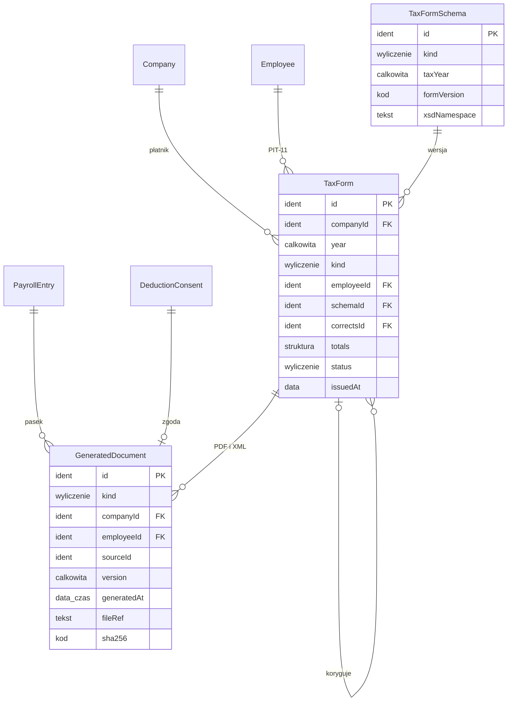

# 10. Dokumenty i PIT — model danych

[← Model domeny](README.md)

Dokumenty generowane przez system: paski wypłat (PDF), zgody na potrącenie do podpisu (PDF) i formularze PIT
(PDF i XML zgodny ze schematem MF na dany rok; decyzja 6). Dokumenty powstają z danych zamkniętych list płac i są
niezmienne; ponowne wygenerowanie tworzy nową wersję. Generują je Kadry, a pracownik widzi swoje w samoobsłudze.
Wysyłki do MF nie ma.

| Encja | Źródło |
|---|---|
| `GeneratedDocument` | zakres (wymagania 9–11: pasek, zgoda, PIT jako pliki) |
| `TaxForm` | zakres (wymaganie 11: PIT-11, PIT-4R, PIT-8AR, korekty) |
| `TaxFormSchema` | *propozycja* — wersja formularza i schematu XSD zmienia się co rok, a XML waliduje się względem schematu |

## Diagram

Encje zewnętrzne: `Company` (01), `Employee` (03), `PayrollEntry` (09), `DeductionConsent` (06).



## Powiązania z innymi domenami

| Kierunek | Powiązanie | Kto jest właścicielem |
|---|---|---|
| ← 09 | pasek z `PayrollEntry` i `PayrollLine`; PIT z sum zamkniętych list roku | Listy płac (dane), Dokumenty (pliki) |
| ← 06 | treść zgody z `DeductionConsent` | Składniki |
| ← 03 | dane osoby i adres zamieszkania na dzień wystawienia PIT-11 | Pracownicy |

---

## GeneratedDocument

Wygenerowany plik. Treść jest odtwarzalna z danych źródłowych, a skrót `sha256` pozwala wykazać, że plik się nie
zmienił. *Niezmienna*; nowa wersja dokumentu to nowy wpis z wyższym `version`.

| Atrybut | Typ | Wym. | Opis |
|---|---|---|---|
| `id` | Identyfikator | tak | **PK**. |
| `kind` | Wyliczenie | tak | `pasek`, `zgoda na potrącenie`, `PIT PDF`, `PIT XML`. |
| `companyId` | Identyfikator | tak | **FK → `Company`**. |
| `employeeId` | Identyfikator | warunkowo | **FK → `Employee`**. Pusty dla PIT-4R i PIT-8AR. |
| `sourceId` | Identyfikator | tak | `PayrollEntry`, `DeductionConsent` albo `TaxForm`, zależnie od `kind`. |
| `version` | Liczba całkowita | tak | Od 1. |
| `generatedAt` | Data i czas | tak | |
| `fileRef` | Tekst | tak | Odwołanie do pliku w magazynie plików (sposób przechowywania opisze plan modułu). |
| `sha256` | Kod | tak | Skrót treści. |

**Reguły:**
- Pasek można wygenerować tylko z listy `zamknięta`.
- Pracownik widzi tylko dokumenty swoich kartotek; odczyt przez Kadry zostawia `ReadAuditEntry`.
- Dokumentu nie usuwa się przed końcem okresu retencji (decyzja 10).

**Przykłady:**

| id | kind | companyId | employeeId | sourceId | version | generatedAt |
|---|---|---|---|---|---|---|
| `PS-ALFA-2026-11-001` | pasek | `CMP-ALFA` | `EMP-ALFA-001` | `PE-ALFA-2026-11-001` | 1 | 2026-11-30 14:05 |
| `DOC-DC-001` | zgoda na potrącenie | `CMP-BETA` | `EMP-BETA-001` | `DC-001` | 1 | 2026-09-24 09:30 |
| `DOC-PIT-ALFA-2026-003-PDF` | PIT PDF | `CMP-ALFA` | `EMP-ALFA-003` | `PIT-ALFA-2026-003` | 1 | 2027-01-15 10:00 |
| `DOC-PIT-ALFA-2026-003-XML` | PIT XML | `CMP-ALFA` | `EMP-ALFA-003` | `PIT-ALFA-2026-003` | 1 | 2027-01-15 10:00 |

- `PS-ALFA-2026-11-001` — pasek Anny za listopad: wszystkie pozycje `PL-11-01`–`PL-11-17` z [09](09-payroll.md#payrollline)
  (pozycje pracodawcy w osobnej sekcji paska).
- `DOC-DC-001` — dokument zgody Ewy na potrącanie 120 zł miesięcznie za kartę sportową, podpisany 25.09.

## TaxForm

Formularz PIT za rok podatkowy: PIT-11 (dla osoby, jeden na kartotekę), PIT-4R i PIT-8AR (dla płatnika). Kwoty są
sumą zamkniętych list z datą wypłaty w danym roku. *Wyliczana* do wystawienia, potem *niezmienna*; zmiana po
wystawieniu to korekta (nowy `TaxForm` z `correctsId`).

| Atrybut | Typ | Wym. | Opis |
|---|---|---|---|
| `id` | Identyfikator | tak | **PK**. |
| `companyId` | Identyfikator | tak | **FK → `Company`**. |
| `year` | Liczba całkowita | tak | Rok podatkowy. |
| `kind` | Wyliczenie | tak | `PIT-11`, `PIT-4R`, `PIT-8AR`. |
| `employeeId` | Identyfikator | warunkowo | **FK → `Employee`**. Wymagany dla PIT-11. |
| `schemaId` | Identyfikator | tak | **FK → `TaxFormSchema`**. |
| `correctsId` | Identyfikator | warunkowo | **FK → `TaxForm`**. Dla korekty. |
| `totals` | Struktura | tak | *(wyliczany)* Pola formularza: dla PIT-11 przychód, koszty, dochód, zaliczka, składki, przychód zwolniony per źródło (umowa o pracę, zlecenie, dzieło); dla PIT-4R zaliczki per miesiąc; dla PIT-8AR ryczałt per miesiąc. |
| `status` | Wyliczenie | tak | `szkic`, `wystawiony`, `skorygowany`. |
| `issuedAt` | Data | warunkowo | Dzień wystawienia. Od niego zależy adres zamieszkania na PIT-11. |

**Statusy:**

```text
szkic → wystawiony → skorygowany (gdy powstanie korekta)
```

**Reguły:**
- Korekta listy płac z datą wypłaty w roku, za który PIT-11 jest już wystawiony, wymaga korekty PIT-11
  (decyzja 8). Silnik oznacza wtedy formularz jako do korekty.
- PIT-8AR powstaje tylko, gdy w roku był ryczałt (umowy do 200 zł). W scenariuszu go nie ma.

**Przykłady:**

| id | companyId | year | kind | employeeId | status | issuedAt |
|---|---|---|---|---|---|---|
| `PIT-ALFA-2026-001` | `CMP-ALFA` | 2026 | PIT-11 | `EMP-ALFA-001` | wystawiony | 2027-01-15 |
| `PIT-ALFA-2026-003` | `CMP-ALFA` | 2026 | PIT-11 | `EMP-ALFA-003` | wystawiony | 2027-01-15 |
| `PIT-BETA-2026-002` | `CMP-BETA` | 2026 | PIT-11 | `EMP-BETA-002` | wystawiony | 2027-01-15 |
| `PIT4R-ALFA-2026` | `CMP-ALFA` | 2026 | PIT-4R | | wystawiony | 2027-01-29 |
| `PIT4R-BETA-2026` | `CMP-BETA` | 2026 | PIT-4R | | wystawiony | 2027-01-29 |

- `PIT-ALFA-2026-001` — Anna w Alfie: sumy obejmują też styczeń–wrzesień (poza scenariuszem) i korektę
  `PAY-ALFA-2026-10-K1` (wypłata w grudniu 2026). Adres z `ADR-002` (aktualny w dniu wystawienia).
- `PIT-ALFA-2026-003` — Marek, zlecenie, tylko październik–grudzień: przychód 9 200,00 zł, koszty 1 587,74 zł,
  dochód 7 612,26 zł, składki społeczne 1 261,32 zł, zdrowotna 714,49 zł, zaliczka 762 zł (265 + 298 + 199).
- `PIT-BETA-2026-002` — Anna w Becie, dzieło: przychód 2 000,00 zł, koszty 1 000,00 zł, dochód 1 000,00 zł,
  zaliczka 120 zł. Druga, niezależna informacja PIT-11 tej samej osoby — dlatego dwa profile mają osobne PIT-y.
- `PIT4R-ALFA-2026` — zaliczki Alfy według miesięcy wypłaty; w scenariuszu: październik 724 zł (459 + 0 + 265),
  listopad 755 zł (457 + 298), grudzień 709 zł (52 korekta + 458 + 199). Styczeń–wrzesień poza scenariuszem.
- `PIT4R-BETA-2026` — październik 934 zł, listopad 934 zł, grudzień 1 738 zł (1 618 Ewa + 120 dzieło Anny).

## TaxFormSchema *(propozycja)*

Wersja formularza i schematu XML dla roku podatkowego. Prowadzi ją Administrator; test sprawdza każdy wygenerowany
XML względem XSD tej wersji.

| Atrybut | Typ | Wym. | Opis |
|---|---|---|---|
| `id` | Identyfikator | tak | **PK**. |
| `kind` | Wyliczenie | tak | `PIT-11`, `PIT-4R`, `PIT-8AR`. |
| `taxYear` | Liczba całkowita | tak | **UK** z `kind`. |
| `formVersion` | Kod | tak | Np. `PIT-11(29)`. |
| `xsdNamespace` | Tekst | tak | Przestrzeń nazw schematu z e-Deklaracji (crd.gov.pl). |

**Przykłady:**

| id | kind | taxYear | formVersion |
|---|---|---|---|
| `TFS-PIT11-2025` | PIT-11 | 2025 | PIT-11(29) |
| `TFS-PIT11-2026` | PIT-11 | 2026 | do ustalenia w styczniu 2027 |

- Za rok 2025 obowiązują PIT-11(29), PIT-4R(13), PIT-8AR(14). Wersje na rok 2026 nie były jeszcze opublikowane
  12.11.2026 — trzeba je sprawdzić na podatki.gov.pl przed wystawieniem PIT za 2026 (pytanie w specyfikacji 010).
