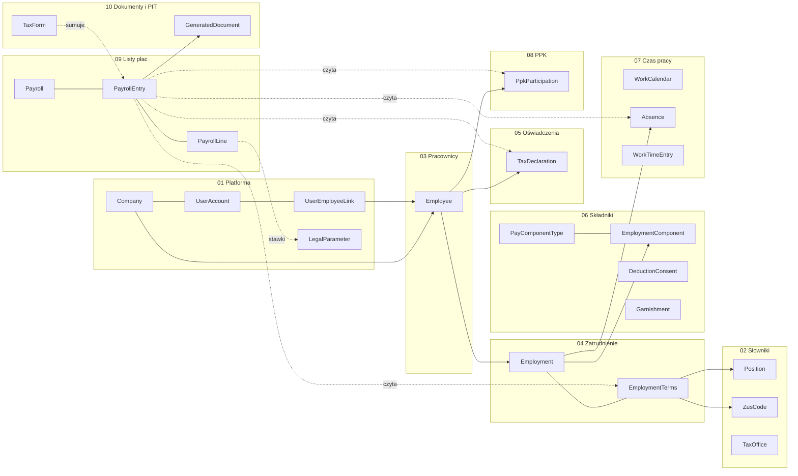

# Model domeny — Kadry i Płace

Logiczny model danych systemu z [PRODUCT.md](../../PRODUCT.md). Model opisuje encje, atrybuty i powiązania bez typów
konkretnej bazy danych. Zakres i decyzje właściciela są w `PRODUCT.md` i ADR-ach (`docs/adr/`); ten folder przekłada
je na encje i pokazuje na jednym spójnym scenariuszu z liczbami policzonymi na stawkach 2026 roku.

Organizacja: jedna grupa, wiele powiązanych spółek. Każda spółka jest osobnym pracodawcą i płatnikiem, ma własne
kartoteki, listy płac i PIT-y. Kadry i Administrator widzą wszystkie spółki, a Pracownik tylko swoje profile.

## 1. Spis plików

| Plik | Domena | Zawartość |
|---|---|---|
| [01-platform.md](01-platform.md) | Platforma | spółki, konta, role, powiązania konto–kartoteka, parametry prawne, audyt |
| [02-dictionaries.md](02-dictionaries.md) | Słowniki | stanowiska, kody ZUS, urzędy skarbowe |
| [03-employees.md](03-employees.md) | Pracownicy | kartoteka w spółce, adresy, rachunki |
| [04-employment.md](04-employment.md) | Zatrudnienie | umowy (o pracę, zlecenie, dzieło), wersje warunków |
| [05-tax-declarations.md](05-tax-declarations.md) | Oświadczenia podatkowe | PIT-2, ulgi, koszty |
| [06-pay-components.md](06-pay-components.md) | Składniki | dodatki i potrącenia, przypisania, zgody, tytuły egzekucyjne |
| [07-time-and-absence.md](07-time-and-absence.md) | Czas pracy i nieobecności | kalendarze, nieobecności, limity urlopu, ewidencja godzin |
| [08-ppk.md](08-ppk.md) | PPK | uczestnictwo, deklaracje |
| [09-payroll.md](09-payroll.md) | Listy płac | lista, wypłata pracownika, pozycje ze śladem, sumy roczne, **parametry 2026 i przeliczenia** |
| [10-documents-and-pit.md](10-documents-and-pit.md) | Dokumenty i PIT | paski, zgody, PIT-11, PIT-4R, PIT-8AR |

## 2. Konwencje

### 2.1. Nazewnictwo

- Encje po angielsku w liczbie pojedynczej (`Employee`, `PayrollEntry`), atrybuty `camelCase`, opisy po polsku.
  Te same nazwy trafiają do tabel (`snake_case`) i API, więc nie ma mapy nazw.
- Klucz główny `id`; klucz obcy `<encja>Id` albo nazwa roli (`correctsPayrollId`).
- Wartości wyliczeń po polsku, tak jak w UI. Kody techniczne wyliczeń ustala plan modułu.

### 2.2. Typy logiczne

| Typ | Token w diagramie | Znaczenie |
|---|---|---|
| Identyfikator | `ident` | jednoznaczny identyfikator |
| Kod | `kod` | kod biznesowy, unikalny w zakresie (NIP, numer umowy, kod ZUS) |
| Tekst | `tekst` | dowolny tekst |
| Liczba całkowita / dziesiętna | `calkowita` / `dziesietna` | liczby bez jednostki (godziny, dni, wartości parametrów) |
| Kwota | `kwota` | wartość w PLN z dokładnością do grosza (waluta zawsze PLN, bez pola waluty) |
| Procent | `procent` | stawka procentowa |
| Data / Data i czas | `data` / `data_czas` | dzień / moment |
| Wartość logiczna | `logiczna` | tak / nie |
| Wyliczenie / (wiele) | `wyliczenie` / `wyliczenie_wiele` | wartości z listy w opisie |
| Adres | `adres` | ulica, numer, kod, miejscowość, kraj |
| Struktura | `struktura` | zestaw nazwanych wartości (np. ślad parametrów naliczenia) |

### 2.3. Oznaczenia

- **PK**, **FK → Encja**, **UK** (unikalny, z zakresem w opisie).
- Kolumna „Wym.”: `tak`, `nie`, `warunkowo` (warunek w opisie).
- *(wyliczany)* — atrybut liczony z innych danych, nie wpisywany ręcznie.
- *Niezmienna* — encji się nie edytuje; korekta to nowy wpis. *Wersjonowana* — zmiana to nowa wersja z okresem.
  *Wyliczana* — cała encja jest wynikiem obliczeń i da się ją odtworzyć.
- *(propozycja)* — encja albo atrybut, którego nie było wprost w zakresie; uzasadnienie przy encji i w sekcji 7.1.

### 2.4. Pola wspólne

Każda encja zapisywana przez użytkownika ma `createdAt`, `createdBy`, `updatedAt`, `updatedBy`; pełna historia zmian
jest w `AuditEntry` ([01](01-platform.md#auditentry)). Tych pól nie powtarzamy w tabelach. Spółkę wyznacza kartoteka
(`Employee.companyId`) albo lista płac (`Payroll.companyId`); encje niżej jej nie powtarzają.

### 2.5. Granice modułów

Moduł zapisuje tylko swoje encje. Lista płac czyta zatrudnienie, czas pracy, składniki, oświadczenia i PPK, ale ich
nie zmienia. Skutek zamknięcia listy (np. ściągnięta kwota tytułu egzekucyjnego, sumy roczne) jest wyliczany z pozycji
zamkniętych list, a nie dopisywany do cudzych encji. Dokumenty (paski, PIT) powstają z danych zamkniętych list.

### 2.6. Przykładowe dane

- Jeden scenariusz (sekcja 5) przez wszystkie domeny. Identyfikatory czytelne (`EMP-ALFA-001`, `PAY-ALFA-2026-11`).
- Dane osobowe fikcyjne, PESEL i rachunki zamaskowane, NIP `000-000-00-0x`, e-maile w domenie `.example`.
- Kwoty liczone na parametrach 2026 ze źródłami ([09. Parametry scenariusza](09-payroll.md#parametry-scenariusza));
  każde przeliczenie jest rozpisane. Te przykłady staną się przypadkami testowymi liczenia wypłat.

## 3. Diagram ogólny

Strzałki ciągłe to klucze obce, przerywane to odczyt przy naliczeniu albo przy generowaniu dokumentu.

## 4. Łańcuch: od umowy do PIT

Opis łańcucha z wpisami scenariusza jest w [09-payroll.md](09-payroll.md#łańcuch-naliczenia).

## 5. Scenariusz przykładowy

### 5.1. Główne dane podstawowe

| Co | Wpisy |
|---|---|
| Spółki | `CMP-ALFA` (Alfa), `CMP-BETA` (Beta) |
| Konta | `USR-ADMIN`, `USR-KADRY`, `USR-ANOWAK` (dwa profile), `USR-EKOW` |
| Kartoteki | `EMP-ALFA-001` Anna Nowak, `EMP-ALFA-002` Piotr Wiśniewski, `EMP-ALFA-003` Marek Zieliński, `EMP-BETA-001` Ewa Kowalczyk, `EMP-BETA-002` Anna Nowak |
| Umowy | `CON-ALFA-001` etat 7 500 zł, `CON-ALFA-002` ½ etatu 2 600 zł, `CON-ALFA-003` zlecenie 40 zł/h, `CON-BETA-001` etat 12 000 zł, `CON-BETA-002` dzieło 2 000 zł |
| Okres | październik–grudzień 2026, PIT za 2026 w styczniu 2027 |

### 5.2. Oś czasu

| Data | Zdarzenie | Wpisy |
|---|---|---|
| 2026-10-01 | podwyżka Anny do 7 500 zł; start zlecenia Marka; zgoda Ewy na kartę sportową zaczyna działać | `TRM-002`, `CON-ALFA-003`, `DC-001` |
| 2026-10-12 | doręczenie zajęcia komorniczego Ewy | `GAR-001` |
| 2026-10-30 (pt) | wypłata za październik, listy zamknięte | `PAY-ALFA-2026-10`, `PAY-ALFA-2026-10-UZ`, `PAY-BETA-2026-10` |
| 2026-11-16–20 | choroba Anny (5 dni) | `ABS-01` |
| 2026-11-26–27 | 4 nadgodziny Anny | `WT-01`, `WT-02` |
| 2026-11-30 (pn) | wypłata za listopad | `PAY-ALFA-2026-11` |
| 2026-12-01 | Anna zmienia adres; start dzieła w Becie | `ADR-002`, `CON-BETA-002` |
| 2026-12-02 | Kadry zauważają pominiętą premię Anny za październik | `EC-002` |
| 2026-12-10 | lista korygująca za październik, wypłata dopłaty | `PAY-ALFA-2026-10-K1` |
| 2026-12-18 | odbiór dzieła, rachunek | `PAY-BETA-2026-12-UD` |
| 2026-12-28–31 | urlop Ewy | `ABS-02` |
| 2026-12-31 (czw) | wypłata za grudzień | `PAY-ALFA-2026-12`, `PAY-BETA-2026-12` |
| 2027-01-15 | PIT-11 za 2026 wystawione | `PIT-ALFA-2026-001`, `PIT-ALFA-2026-003`, `PIT-BETA-2026-002` |
| 2027-01-29 | PIT-4R za 2026 wystawione | `PIT4R-ALFA-2026`, `PIT4R-BETA-2026` |

Szczegóły list i przeliczeń: [09](09-payroll.md); PIT: [10](10-documents-and-pit.md).

## 6. Miejsca rozszerzenia

- **Deklaracje ZUS** — poza zakresem (decyzja 7). Gdyby wróciły: dokumenty rozliczeniowe liczy się z `PayrollLine`
  (składki) i `EmploymentTerms` (kody), więc model nie wymaga zmian, tylko nowych encji dokumentów.
- **Przelewy** — `EmployeeBankAccount` i netto z `PayrollEntry` wystarczą do pliku przelewów, gdy będzie potrzebny.
- **Dostęp per spółka** — dziś Kadry i Administrator widzą wszystkie spółki. Zawężenie wymagałoby encji
  `UserCompanyAccess` (konto, spółka).
- **Inne rezydencje podatkowe** — `Employee.taxResidence` ma dziś jedną wartość `PL`.

## 7. Założenia i propozycje

### 7.1. Encje zaproponowane

| Encja | Domena | Uzasadnienie |
|---|---|---|
| `CompanyRate` | 01 | stopa wypadkowa zależy od płatnika i roku składkowego |
| `TaxOffice` | 02 | urząd skarbowy pracownika i płatnika jest polem PIT-11, PIT-4R, PIT-8AR |
| `EmployeeAddress` | 03 | PIT-11 wymaga adresu na dzień wystawienia, adres się zmienia |
| `EmployeeBankAccount` | 03 | wypłata przelewem; numer zaszyfrowany z historią |
| `Garnishment` | 06 | kolejność i limity potrąceń zależą od tytułu i jego kwoty |
| `LeaveEntitlement` | 07 | pilnowanie limitu urlopu i podstawa ekwiwalentu |
| `WorkTimeEntry` (godziny zlecenia) | 07 | minimalna stawka godzinowa wymaga ewidencji godzin zleceniobiorcy |
| `AnnualAccumulator` | 09 | narastające sumy roku (podstawa do 30-krotności, przychody do progu PIT, limit ulgi dla młodych, koszty autorskie) — wyliczana z zamkniętych list |
| `TaxFormSchema` | 10 | wersja formularza i schematu XML zmienia się co rok |

### 7.2. Założenia modelu

1. Wynagrodzenie za miesiąc jest płatne w ostatnim dniu roboczym tego miesiąca (październik 30.10, listopad 30.11,
   grudzień 31.12). Termin wypłaty jest polem listy, więc inna praktyka spółki nic w modelu nie zmienia.
2. Pracownik etatowy ma wynagrodzenie miesięczne stałe; składniki godzinowe (nadgodziny) liczy się ze stawki
   zasadniczego podzielonego przez wymiar godzin miesiąca.
3. Wynagrodzenie urlopowe przy stałym wynagrodzeniu miesięcznym równa się zasadniczemu za te dni (brak zmiennych
   składników w scenariuszu).
4. Oświadczenia i dokumenty pracownik składa na papierze; system je rejestruje, a podpis elektroniczny jest poza
   zakresem.
5. Dane z poprzednich lat (np. podstawa chorobowego z 12 miesięcy) w scenariuszu wynikają ze stałej pensji, więc
   nie modelujemy list sprzed października 2026 — tylko wspominamy wrzesień.

### 7.3. Pytania otwarte

1. Czy zlecenie z własnym pracownikiem (umowa o pracę i zlecenie w tej samej spółce) ma być obsłużone w pierwszej
   wersji liczenia, czy wystarczy blokada takiego zbiegu z komunikatem?
2. Czy lista płac ma obsługiwać kilka wypłat w miesiącu dla tej samej umowy (np. premia osobno), czy jedna lista
   miesięczna na rodzaj umowy plus listy korygujące wystarczą?
3. Czy pasek ma być wysyłany e-mailem pracownikowi (z hasłem), czy tylko dostępny w samoobsłudze?
